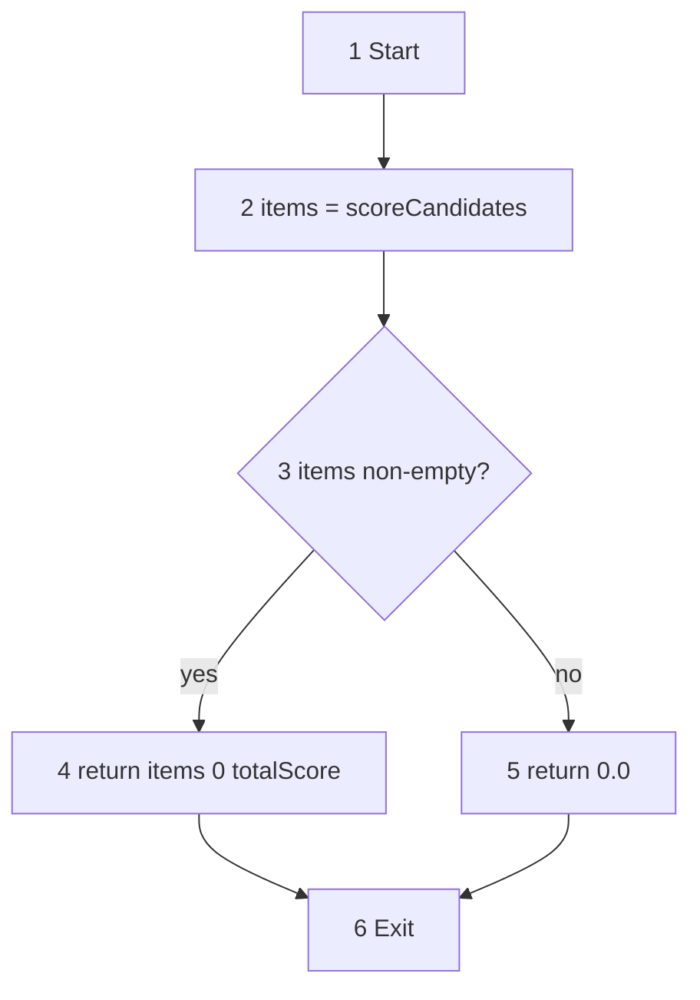
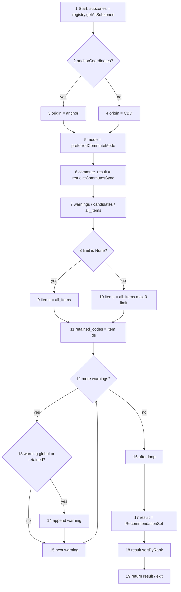

# Formal White-Box Testing — Scoring and Ranking

- **Version:** 1.0
- **Date:** 24 October 2026
- **Units under test:**
  - `WeightedScoringStrategy.computeSuitabilityScore`
  - `RankingControl.generateRankedRecommendations`
- **Test suite:** `backend/tests/test_white_box.py`
- **Execution:** `python -m unittest tests.test_white_box -v`
- **Result:** **9 tests — all passed**

---

## 1. Objective

Apply structural testing to the two units named in the Phase 4 gap list:

1. derive a control-flow graph (CFG) for each unit;
2. calculate cyclomatic complexity `V(G)`;
3. identify a basis set of independent paths;
4. implement test cases that traverse every basis path;
5. record expected and actual results.

## 2. Scope and assumptions

### In scope

- `WeightedScoringStrategy.computeSuitabilityScore`
- `RankingControl.generateRankedRecommendations`
- Decision outcomes for:
  - presence/absence of a profile anchor;
  - `limit=None` vs a numeric limit;
  - warning-filter keep/drop;
  - warning-loop entry/exit;
  - non-empty vs empty scoring results.

### Out of scope

- A full CFG for `WeightedScoringStrategy.scoreCandidates`. That helper is
  exercised by `test_scoring_ranking.py`; `computeSuitabilityScore` treats it
  as a called unit.
- Exception paths. Neither method catches exceptions, so failures propagate to
  the caller and do not create additional internal CFG decisions.
- Performance, concurrency and data-quality behaviour.

### Graph conventions

- One node per statement group or predicate.
- `V(G) = E − N + 2P`, where `P` is the number of connected components (`P=1`
  for each method).
- Equivalent form: `V(G) = number_of_predicate_nodes + 1`.
- List comprehensions that filter items are expanded into a loop-header node,
  a filter-predicate node, an append node and a back-edge.

## 3. Unit 1 — `WeightedScoringStrategy.computeSuitabilityScore`

### 3.1 Source

```python
items = self.scoreCandidates([subzone], profile, {subzone.subzoneCode: commute})
return items[0].totalScore if items else 0.0
```

### 3.2 Control-flow graph



| Node | Statement |
| --- | --- |
| 1 | Enter method |
| 2 | Call `scoreCandidates` with a one-candidate cohort |
| 3 | Predicate: `items` is truthy |
| 4 | Return `items[0].totalScore` |
| 5 | Return `0.0` |
| 6 | Exit |

### 3.3 Cyclomatic complexity

| Metric | Value |
| --- | --- |
| Nodes `N` | 6 |
| Edges `E` | 6 |
| Connected components `P` | 1 |
| Predicate nodes | 1 (`items` truthy) |
| `V(G)` | `6 − 6 + 2 = 2` |

### 3.4 Basis paths

| Path | Node sequence | Condition |
| --- | --- | --- |
| BP-CSS-1 | 1 → 2 → 3 → 4 → 6 | `scoreCandidates` returns at least one item |
| BP-CSS-2 | 1 → 2 → 3 → 5 → 6 | `scoreCandidates` returns an empty list |

Both paths are feasible.

### 3.5 Basis-path tests

| Test ID | Path | Setup | Expected | Actual | Status |
| --- | --- | --- | --- | --- | --- |
| WB-CSS-01 | BP-CSS-1 | Fixture subzone, valid profile, commute estimate | Return equals `scoreCandidates(...)[0].totalScore`; value in `[0, 100]` | Matched | Pass |
| WB-CSS-02 | BP-CSS-2 | Same candidate but `minimumPrimarySchools=2` so the hard filter removes it | Return `0.0` | Returned `0.0` | Pass |

## 4. Unit 2 — `RankingControl.generateRankedRecommendations`

### 4.1 Source structure

The method performs:

1. load all subzones;
2. choose the profile anchor or fall back to the CBD;
3. retrieve commute estimates synchronously;
4. score every candidate;
5. apply the optional result limit;
6. retain warnings whose `subzoneCode` is global (`None`) or belongs to a
   retained item;
7. build, sort and return a `RecommendationSet`.

The warning filter is a list comprehension and is expanded in the CFG because
it affects which warnings reach the result.

### 4.2 Control-flow graph



| Node | Statement group |
| --- | --- |
| 1 | Import `RecommendationSet`; `subzones = getAllSubzones()` |
| 2 | Predicate: `profile.anchorCoordinates` truthy |
| 3 | `origin = profile.anchorCoordinates` |
| 4 | `origin = Coordinates(CBD_LATITUDE, CBD_LONGITUDE)` |
| 5 | `mode = profile.preferredCommuteMode` |
| 6 | `commute_result = retrieveCommutesSync(...)` |
| 7 | `warnings = list(...)`; `candidates = subzones`; `all_items = scoreCandidates(...)` |
| 8 | Predicate: `limit is None` |
| 9 | `items = all_items` |
| 10 | `items = all_items[:max(0, limit)]` |
| 11 | `retained_codes = {item.subzoneId ...}` |
| 12 | Loop header: `for warning in warnings` |
| 13 | Filter predicate: `warning.subzoneCode is None or warning.subzoneCode in retained_codes` |
| 14 | Append warning to filtered list |
| 15 | Advance to next warning |
| 16 | After-loop warning list |
| 17 | Build `RecommendationSet` |
| 18 | `result.sortByRank()` |
| 19 | Return result / exit |

### 4.3 Cyclomatic complexity

| Metric | Value |
| --- | --- |
| Nodes `N` | 19 |
| Edges `E` | 22 |
| Connected components `P` | 1 |
| Predicate nodes | 4 (anchor, limit, loop, warning filter) |
| `V(G)` | `22 − 19 + 2 = 5` |

### 4.4 Basis paths

| Path | Predicate outcomes | Node sequence |
| --- | --- | --- |
| BP-RR-1 | anchor yes; limit None; loop entered; warning kept | 1-2-3-5-6-7-8-9-11-12-13-14-15-12-16-17-18-19 |
| BP-RR-2 | anchor no; limit None; loop entered; warning kept | 1-2-4-5-6-7-8-9-11-12-13-14-15-12-16-17-18-19 |
| BP-RR-3 | anchor yes; limit numeric; loop entered; warning kept | 1-2-3-5-6-7-8-10-11-12-13-14-15-12-16-17-18-19 |
| BP-RR-4 | anchor yes; limit None; loop entered; warning dropped | 1-2-3-5-6-7-8-9-11-12-13-15-12-16-17-18-19 |
| BP-RR-5 | anchor yes; limit None; loop not entered | 1-2-3-5-6-7-8-9-11-12-16-17-18-19 |

All five paths are feasible and are covered by the tests below.

### 4.5 Basis-path tests

| Test ID | Path | Setup | Expected | Actual | Status |
| --- | --- | --- | --- | --- | --- |
| WB-RR-01 | BP-RR-1 | Anchor present; `limit=None`; warnings global + retained + unknown | 3 items; origin = anchor; warnings `[None, TAMPINES01]`; snapshot `WB-SNAPSHOT` | Matched | Pass |
| WB-RR-02 | BP-RR-2 | Anchor `None`; `limit=None`; retained warning | Origin = CBD coordinates; 3 items; retained warning kept | Matched | Pass |
| WB-RR-03 | BP-RR-3 | Anchor present; `limit=3`; retained warning | 3 items; retained warning kept | Matched | Pass |
| WB-RR-04 | BP-RR-4 | Anchor present; `limit=None`; warning for `UNKNOWN` subzone | Warning dropped; result warnings empty | Matched | Pass |
| WB-RR-07 | BP-RR-5 | Anchor present; `limit=None`; empty warning list | 3 items; no warnings | Matched | Pass |

### 4.6 Supplementary boundary tests

These are not additional basis paths, but exercise the numeric-limit boundary
inside the false branch of node 8.

| Test ID | Setup | Expected | Actual | Status |
| --- | --- | --- | --- | --- |
| WB-RR-05 | `limit=0`; global + retained warnings | No items; only global warning retained | Matched | Pass |
| WB-RR-06 | `limit=-5` | `max(0, limit)` produces no items | Matched | Pass |

## 5. Coverage summary

| Unit | Statement coverage | Branch/decision coverage | Basis paths covered |
| --- | --- | --- | --- |
| `computeSuitabilityScore` | All statements | `items` true and false | 2 / 2 |
| `generateRankedRecommendations` | All statements | anchor true/false; limit None/numeric; loop entered/not entered; warning kept/dropped | 5 / 5 |

Coverage was established by test design and assertions rather than a
line-coverage tool. Every CFG node is reached by at least one basis path, and
every predicate outcome is exercised by at least one test.

## 6. Combined complexity

| Unit | `V(G)` | Basis paths | Test IDs |
| --- | --- | --- | --- |
| `computeSuitabilityScore` | 2 | 2 | WB-CSS-01, WB-CSS-02 |
| `generateRankedRecommendations` | 5 | 5 | WB-RR-01 to WB-RR-04, WB-RR-07 |
| Supplementary boundary tests | — | 2 extra | WB-RR-05, WB-RR-06 |

## 7. Observations and defects

**No defects were found in the analysed units.**

Documented structural behaviours:

1. **CBD fallback.** When `profile.anchorCoordinates` is `None`, the method
   uses the CBD coordinates before calling the commute boundary.
2. **Negative and zero limits.** `max(0, limit)` safely prevents a negative
   slice; `limit=0` returns no recommendations.
3. **Global warnings survive filtering.** Warnings with `subzoneCode=None` are
   retained even when no items survive the limit.
4. **Subzone warnings are item-bound.** A warning for a subzone outside the
   retained result is dropped after slicing.
5. **Empty scoring cohort.** `computeSuitabilityScore` returns `0.0` when hard
   filters remove the only candidate.

## 8. Limitations

- The CFG is method-level. Loops and comprehensions are represented at the
  loop-header/filter level; iteration counts are not modelled individually.
- `scoreCandidates` is treated as a called unit by
  `computeSuitabilityScore`. Its many internal branches are covered by
  `test_scoring_ranking.py` but are not part of this CFG.
- No formal `coverage.py` statement/branch report was generated; coverage is
  demonstrated through basis-path tests and assertions.
- Exception propagation and external I/O failures are outside these CFGs.
- Only `computeSuitabilityScore` and `generateRankedRecommendations` are
  analysed, matching the Phase 4 gap list.

## 9. Reproduction

```powershell
cd Lab4/revised-skeleton/backend
python -m unittest tests.test_white_box -v
```

Observed summary:

```text
Ran 9 tests in 0.014s

OK
```

Full backend regression suite:

```powershell
cd Lab4/revised-skeleton
make test
```

Observed summary at the time of writing:

```text
Ran 145 tests
OK
```

## 10. Traceability

| Requirement | Evidence |
| --- | --- |
| CFG for ranking | Section 4.2 |
| CFG for scoring wrapper | Section 3.2 |
| Cyclomatic complexity | Sections 3.3 and 4.3 |
| Basis-path test-case table | Sections 3.4, 4.4 and 4.5 |
| Implemented tests | `backend/tests/test_white_box.py` |
| Expected/actual results | Sections 3.5, 4.5 and 4.6 |
