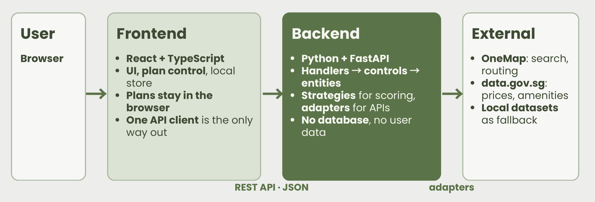
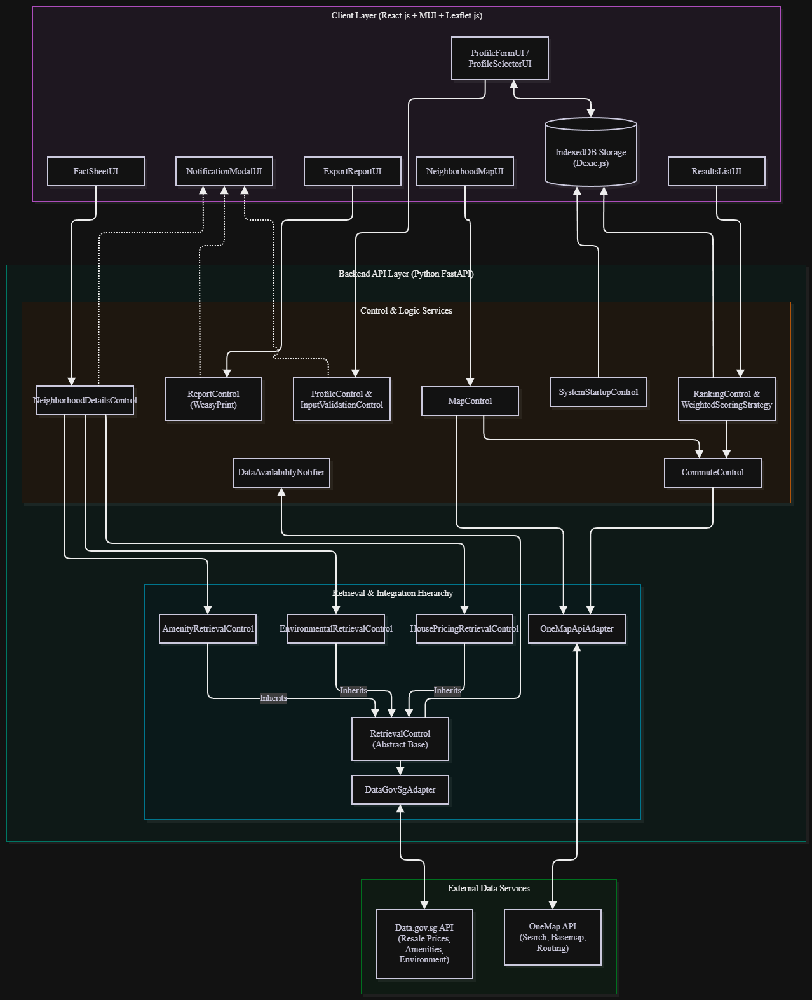

<h1 align="center">SG Property Finder</h1>

<p align="center"><b>A neighbourhood recommender for Singapore home buyers and renters: it scores all 332 planning subzones against a weighted preference profile, using live government data, and shows the ranking on a map.</b></p>

<p align="center">
  <a href="https://github.com/DangKartik/sg-property-finder/actions/workflows/tests.yml"></a>
  
  
  
  
  
</p>

**Topics:** multi-criteria ranking · weighted scoring · geospatial data · GeoPandas · REST API design · FastAPI · React · TypeScript · Leaflet · IndexedDB · strategy and adapter patterns · white-box and black-box testing · requirements traceability

The user describes what matters (budget, flat type, workplace, schools, amenities, green space), rates each criterion from 1 to 10, and gets the top 20 subzones on a map, each with a fact sheet, a commute estimate and a side-by-side comparison. Prices come from data.gov.sg's HDB resale records and routing from OneMap. A PDF report records the profile, the scores, the data dates and every assumption.

**[Watch the demo video](https://youtu.be/2Ll_OThlgXo)**

<p align="center"></p>

## Key results

| | Result |
|---|---|
| **How is a subzone scored?** | Budget is a hard filter, then each criterion is normalised against a **fixed absolute domain** (for example 0 to 90 minutes of commute), not against the other candidates, so a subzone's score does not move when the candidate set changes. Ratings are renormalised into weights, and the total is 100 × the weighted sum. Ties break on commute time, then on median price per square metre. |
| **How does it treat missing data?** | A missing value is not a zero. It is flagged and dropped from that subzone's weighted sum, while a real zero (no malls within 1 km) is scored as zero. 13 of 332 subzones (mostly islands) lack commute data and are excluded from rankings rather than guessed. |
| **Is it fast enough?** | Against targets of 5 s for a ranking and 10 s for a routed commute: cold ranking p95 **2.27 s**, warm p95 **0.28 s**, OneMap routing p95 **0.52 s** (single client, localhost, `make benchmark`). |
| **How is it tested?** | **168 backend tests** (unit, white-box basis-path tests of the ranking logic, black-box equivalence-class, boundary-value and state-transition tests) and **43 frontend component tests**. External APIs sit behind adapters that tests replace with fakes, so CI runs fully offline. |
| **Does it meet its requirements?** | 20 requirements are traced to code and tests. 10 of 11 functional requirements are verified. Of the 9 non-functional requirements, 1 is verified (performance), 1 is verified by inspection, 5 are partly verified, and 2 (uptime and load) are not verified, because the app was never deployed. |

**Read this first.** HDB resale data has no subzone code, so every price is the median for the subzone's HDB town and is labelled as a proxy. Green-coverage and PM2.5 baselines are supplied regional values, not a verified time series. There is no login: profiles live in the browser.

## Team

Built by a team of five for NTU's SC2006 (Software Engineering). Responsibilities were shared rather than split by component, so everyone worked across requirements, design, implementation and testing.

## Architecture

<p align="center"></p>

- **Stateless backend.** FastAPI serves a JSON API under `/api/v1` and holds no user database; the only server state is TTL caches and a short-lived store of generated PDFs. Profiles and cached responses live in the browser's IndexedDB (Dexie).
- **Boundary, control and entity layers** on both sides, with a composition root (`backend/app/bootstrap.py`) that wires every concrete class in one place.
- **Strategy pattern.** `RankingControl` receives a `ScoringStrategy` through its constructor, so the scoring method can change without touching ranking.
- **Adapter pattern.** `OneMapApiAdapter` and `DataGovSgAdapter` isolate the external APIs, including OneMap's token exchange with cached, automatically refreshed tokens.
- **Commute model.** Public transport to the CBD uses a precomputed subzone matrix; custom workplaces use live OneMap routing; if routing fails, the app falls back to a straight-line estimate with a visible warning.

The class diagram, use case diagram and dialog map are in [docs/diagrams](docs/diagrams).

## Tech stack

| Area | Technology |
|---|---|
| Backend | Python 3.11+, FastAPI, Pydantic, httpx, pandas, GeoPandas, Shapely, ReportLab |
| Frontend | React 18, TypeScript, Vite, Leaflet and React-Leaflet, Dexie (IndexedDB) |
| Data | data.gov.sg (HDB resale prices, amenities, environment), OneMap (geocoding, routing, basemap), bundled subzone boundaries and commute matrix |
| Testing | `unittest`/pytest (backend), Vitest and Testing Library (frontend), GitHub Actions |

## Run it

You need Python 3.11+, Node.js 24 (or 22.22+), GNU Make and a free [OneMap](https://www.onemap.gov.sg/apidocs/) account (the backend needs it to start).

```bash
cp .env.example .env        # then set ONEMAP_EMAIL and ONEMAP_PASSWORD
make install
make dev                    # backend on :8000, frontend on :5173
```

Open <http://localhost:5173>. The tests need no credentials or network:

```bash
make test                   # 168 backend tests
make test-frontend          # 43 frontend tests
make benchmark              # latency benchmark against a spawned server
```

Windows instructions, running without Make, and troubleshooting are in [docs/SETUP.md](docs/SETUP.md).

## Repository layout

| Path | Contents |
|---|---|
| `backend/app` | FastAPI app: `api`, `control`, `entity`, `strategy`, `adapter`, `container`, `services`, `bootstrap.py` |
| `backend/tests` | unit, white-box and black-box suites, with fixtures and API fakes |
| `backend/assets/data` | subzone boundaries, HDB resale snapshot, amenities, commute matrix, environment baselines |
| `frontend/src` | React app: `boundary` (UI components), `control`, `container` (IndexedDB), `api`, `types` |
| `scripts` | dev server, benchmark, test runner and amenity data build |
| `docs` | specification, architecture, class references, test reports, traceability, limitations, diagrams |

## Documentation

| Document | What it covers |
|---|---|
| [SPECIFICATIONS_AND_ARCHITECTURE.md](docs/SPECIFICATIONS_AND_ARCHITECTURE.md) | criterion catalogue, normalisation and scoring rules, API and report contracts |
| [REQUIREMENTS_TRACEABILITY.md](docs/REQUIREMENTS_TRACEABILITY.md) | every requirement and use case mapped to classes, tests and a verification status |
| [WHITE_BOX_TESTING.md](docs/WHITE_BOX_TESTING.md), [BLACK_BOX_TESTING.md](docs/BLACK_BOX_TESTING.md) | test design and results |
| [EXTERNAL_API_DATA.md](docs/EXTERNAL_API_DATA.md) | how each data.gov.sg and OneMap source is fetched, cached and refreshed |
| [BACKEND_CLASS_REFERENCE.md](docs/BACKEND_CLASS_REFERENCE.md), [FRONTEND_CLASS_REFERENCE.md](docs/FRONTEND_CLASS_REFERENCE.md) | every class and its methods |
| [LIMITATIONS.md](docs/LIMITATIONS.md) | known data, functional and production limits |

## Limitations

- **Town-level prices.** HDB resale data cannot be resolved below the HDB town, so neighbouring subzones in one town share a price.
- **Supplied environment baselines.** Green coverage and PM2.5 baselines are regional values; live PM2.5, UV and weather are shown but do not affect ranking. No subzone-level noise data was available, so noise is not scored.
- **No independent accuracy check.** The formulas are tested, but rankings were never reconciled against a second data source.
- **Not production-ready.** No authentication or cross-device sync, and the PDF store is single-process, so a multi-worker deployment would need shared storage. No load test was run.
- **Fallback commutes are not cached**, which causes occasional tail latency on repeated rankings.
