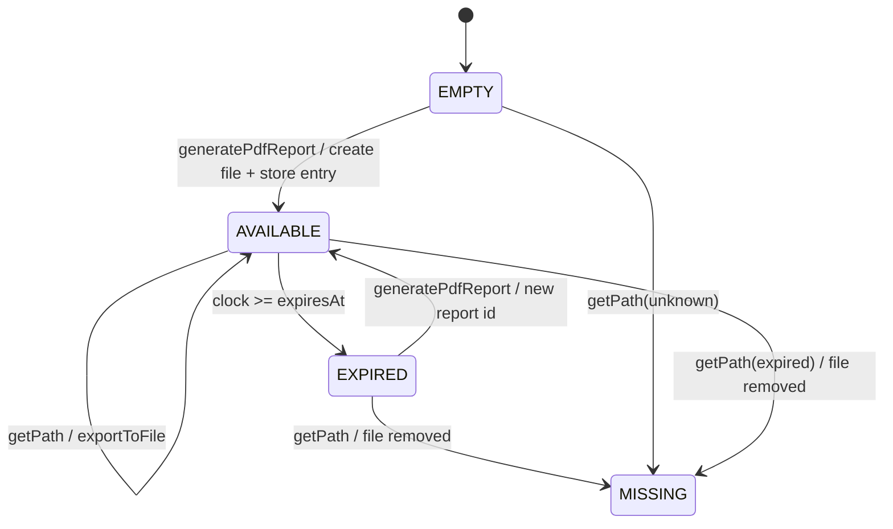
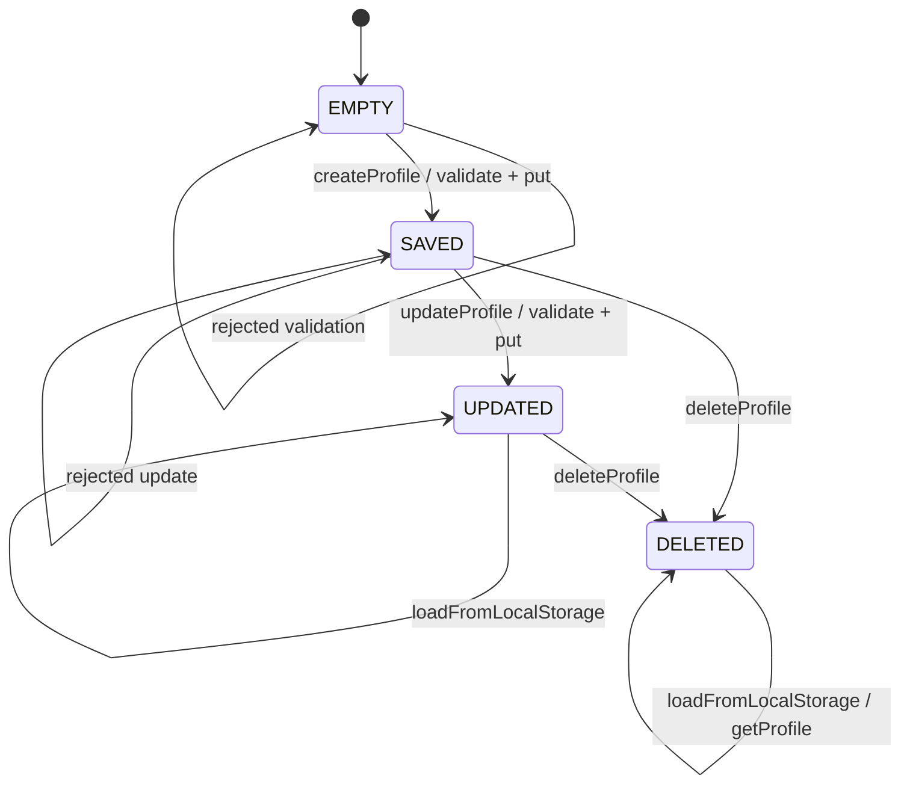

# Formal Black-Box Testing

- **Version:** 2.0
- **Date:** 26 October 2026
- **System under test:** profile validation, browser profile lifecycle and PDF report lifecycle
- **Techniques:** equivalence-class partitioning (EP), boundary-value analysis (BVA), state-transition testing
- **Test suites:**
  - `backend/tests/test_black_box_validation.py` — EP/BVA (37 methods, 68 logical cases)
  - `backend/tests/test_black_box_state.py` — report state machine (8 tests)
  - `frontend/src/control/ProfileControl.test.ts` — profile state machine (7 tests)
- **Result:** **52 test methods / 83 logical cases — all passed**

---

## 0. Assignment requirement mapping

| Requirement | Evidence in this document |
| --- | --- |
| 3.2.1 — EP/BVA for one important control class | `InputValidationControl` is tested through the `handlers.validateProfile` boundary; EP classes and BVA tables are in sections 5.1–5.2 and 6. |
| 3.2.2 — basis path testing for two complex methods | Covered in `WHITE_BOX_TESTING.md`: `WeightedScoringStrategy.scoreCandidates` (`V(G)=6`) and `RankingControl.generateRankedRecommendations` (`V(G)=5`). |
| 3.2.3 — minimise test cases | One baseline payload, one-factor-at-a-time classes and boundary values; no full cross-product. The minimisation rationale is in section 4.4. |
| 3.2.4 — execute and document results | Every table records Input, Oracle and Log; section 10 records execution summaries. |
| Test report format | Each row is a test case with Name, Location, Input, Oracle, Log and Status. |

---

## 1. Objective

Show that the externally observable behaviour matches the specification, so any
failure can be fixed before release. The black-box suites derive cases from the
requirements and public interfaces only:

1. **Equivalence-class partitioning** for profile fields.
2. **Boundary-value analysis** at every numeric and collection boundary.
3. **State-transition testing** for the report and profile lifecycles.

No validator internals, private scoring methods or storage internals are used to
decide expected results. The tests inspect returned envelopes, stored profiles,
report paths and files.

## 2. Systems under test and test boundaries

| System under test | Public boundary | Suite | Technique |
| --- | --- | --- | --- |
| Profile validation | `handlers.validateProfile(payload, context)` — the same path as `POST /api/v1/profiles/validate` | `test_black_box_validation.py` | EP + BVA |
| PDF report lifecycle | `ReportControl.generatePdfReport`, `ReportControl.exportToFile`, `ReportStore.getPath` and `handlers.reportPath` | `test_black_box_state.py` | State transition |
| Browser profile lifecycle | `ProfileControl.createProfile/updateProfile/deleteProfile` + `ProfileCatalog.loadFromLocalStorage` | `ProfileControl.test.ts` | State transition |

### 2.1 Profile-validation boundary

The handler performs three steps:

1. parse the payload into `ProfileDTO` through `profileDtoFromDict`;
2. call `InputValidationControl.validateProfileData`;
3. return an `ApiEnvelope`.

Two rejection mechanisms are tested separately:

| Mechanism | Envelope | Meaning |
| --- | --- | --- |
| Parse rejection | `success=false`, `error.code=INVALID_PROFILE` | Payload shape, type, enum or coercion failure |
| Validation rejection | `success=true`, `data.isValid=false` | Parseable payload violates a business rule |

### 2.2 Out of scope

- Live OneMap/data.gov.sg timing; see NFR-02 in `REQUIREMENTS_TRACEABILITY.md`.
- Ranking quality and scoring maths; see `WHITE_BOX_TESTING.md`.
- Accessibility and browser rendering; see `LIMITATIONS.md` and `REQUIREMENTS_TRACEABILITY.md`.
- Security penetration testing and production concurrency.

## 3. Levels of testing

The lecture levels are applied as follows. This document contributes mainly
unit/integration evidence; the system and acceptance evidence is maintained in
the linked documents so the level boundaries stay clear.

| Level | What it means here | Evidence |
| --- | --- | --- |
| **Unit** | One class or pure helper with stubs | `backend/tests/test_scoring_ranking.py`, `test_report.py`, `test_polyline.py`; `frontend/src/utils/*.test.ts`, `ApiCache.test.ts` |
| **Integration** | Two or more units combined at a real boundary | `test_black_box_validation.py` (handler + validator + address adapter), `test_black_box_state.py` (control + store + handler), `test_api_handlers.py`, `test_fastapi_endpoints.py`, `frontend/src/control/ProfileControl.test.ts` (control + Dexie + validator contract) |
| **System** | The complete backend/frontend system | `REQUIREMENTS_TRACEABILITY.md` (18-check walkthrough summary and NFR-02 benchmark) |
| **Acceptance** | The customer/user can complete the intended journeys | `REQUIREMENTS_TRACEABILITY.md`: create plan, search address, rank, open factsheet, compare, export PDF, import share link, persist after reload, delete safely |

The new state suites are integration tests: they exercise a controller against
its real in-memory/IndexedDB collaborator, not a mock of the whole workflow.

## 4. Test environment and data

| Item | Value |
| --- | --- |
| Backend language/runtime | Python 3.14 |
| Backend test framework | `unittest` |
| Frontend test framework | Vitest + jsdom + `fake-indexeddb` |
| Baseline profile | `tests.support.profilePayload()` |
| Address adapter | `tests.support.FakeOneMap` |
| Address outage | Local `ExplodingOneMap` stub |
| Report clock | Injected `MutableClock` in `test_black_box_state.py` |
| External network | None |
| Fixtures | Three subzones and 16 amenity points under `backend/tests/fixtures/` |

The baseline profile is a valid plan with a `Raffles Place` workplace, anchor
coordinates, five 1–10 criterion ratings and all hard minimums set to zero.

## 5. Techniques

### 5.1 Equivalence-class partitioning

Each input domain is divided into valid and invalid classes. One representative
value per class is submitted while the rest of the payload stays valid.

| Input domain | Valid class | Invalid classes | Test IDs |
| --- | --- | --- | --- |
| `profileName` | Non-empty, non-whitespace string | Empty string; whitespace-only | BB-VAL-01, 02, 03 |
| `budgetMin` | `>= 0` | `< 0` | BB-VAL-04, 23, 33 |
| `budgetMax` | `> 0` and `> budgetMin` | Zero; equal to `budgetMin`; below `budgetMin` | BB-VAL-05, 06, 24, 34 |
| `selectedFlatTypes` | At least one supported flat type | Empty list; unparseable flat type | BB-VAL-07, 17, 18 |
| Workplace/anchor | Address resolvable or anchor supplied | Neither supplied; address not found; address lookup error | BB-VAL-08, 09, 10, 11, 12 |
| `criteriaWeights` | At least one known criterion, rating in `[1, 10]` | Empty list; unknown criterion; rating `< 1`; rating `> 10` | BB-VAL-13, 14, 19, 20, 21, 22, 35, 37 |
| `preferredCommuteMode` | `PUBLIC_TRANSIT`, `DRIVING`, `WALKING`, or omitted | Unparseable value such as `CYCLING` | BB-VAL-15, 16, 36 |
| Hard minimum counts | Whole number in `[0, 50]` | Negative; non-integer; boolean; `> 50` | BB-VAL-25 to 32 |
| Report identity | Existing, non-expired ID | Unknown ID; expired ID | BB-ST-01 to 08 |
| Profile identity | Existing, valid profile | Unknown ID; invalid update | BB-ST-FE-01 to 07 |

### 5.2 Boundary-value analysis

For numeric and range-based rules, values immediately below, at and above each
boundary were tested:

- `-1 / 0 / 1`
- `49 / 50 / 51`
- importance ratings `0 / 1 / 10 / 11`
- budget bounds at `0`, equal values and `minimum + 1`
- report expiry at 15 minutes (`+16` minutes in tests)

| Variable | Below boundary | At boundary | Above boundary | Test IDs |
| --- | --- | --- | --- | --- |
| `budgetMin` | `-1` → invalid | `0` → valid; `1` → valid | — | BB-VAL-04, 23, 33 |
| `budgetMax` with `budgetMin=500000` | `0` → invalid | `500000` → invalid (equal) | `500001` → valid | BB-VAL-05, 06, 24 |
| `budgetMax` with `budgetMin=0` | — | `1` → valid | — | BB-VAL-34 |
| Importance rating | `0` → invalid | `1` and `10` → valid | `11` → invalid | BB-VAL-19, 20, 21, 22 |
| Minimum count | `-1` → parse-invalid | `0`, `1`, `49`, `50` → valid | `51` → validation-invalid | BB-VAL-25, 26, 27, 28, 32 |
| Minimum value type | `1.5`, `true`, `-1` → parse-invalid | Integer `0` → valid | Numeric string `"5"` → valid | BB-VAL-28, 29, 30, 31 |
| Flat types | `0` → invalid | `1` → valid | `3` → valid | BB-VAL-07, 17 |
| Criteria list | `0` → invalid | `1` → valid | `5` → valid; unknown ID → invalid | BB-VAL-13, 14, 35 |
| Commute mode | Omitted → defaults to `PUBLIC_TRANSIT` | All three modes → valid | `CYCLING` → parse-invalid | BB-VAL-15, 16, 36 |
| Report expiry | Just before expiry → available | At expiry → invalid | `+16` minutes → expired | BB-ST-03, BB-ST-05, BB-ST-08 |

### 5.3 State-based testing

#### Report state machine



| State | Meaning |
| --- | --- |
| `EMPTY` | No report has been generated. |
| `AVAILABLE` | `reportId` maps to an existing PDF and `now < expiresAt`. |
| `EXPIRED` | `now >= expiresAt`; the entry is removed on lookup. |
| `MISSING` | The ID is unknown or has already been expired and removed. |

| Transition | Event | Guard / action | Test |
| --- | --- | --- | --- |
| `EMPTY → AVAILABLE` | Generate report | PDF written; store entry added with `expiresAt = generated + 15 min` | BB-ST-01 |
| `AVAILABLE → AVAILABLE` | Read/download | `getPath` / `handlers.reportPath` returns the same path | BB-ST-02 |
| `AVAILABLE → AVAILABLE` | Export | `exportToFile` copies the PDF | BB-ST-04 |
| `AVAILABLE → EXPIRED` | Clock reaches expiry | Lookup returns `None`; file is deleted | BB-ST-03 |
| `EXPIRED → EXPIRED` | Export after expiry | `exportToFile` returns `False`; no copy | BB-ST-05 |
| `EXPIRED → AVAILABLE` | Generate again | New ID and file; old ID remains missing | BB-ST-06 |
| `EMPTY → MISSING` | Read unknown ID | `None` | BB-ST-07 |
| Cascade | Generate → read → export → expire → read → regenerate | Each step depends on the previous state | BB-ST-08 |

#### Profile state machine



| Transition | Event | Guard / action | Test |
| --- | --- | --- | --- |
| `EMPTY → SAVED` | Create valid profile | Validator accepts; Dexie `put`; timestamps set | BB-ST-FE-01 |
| `SAVED → SAVED` | Reload | `loadFromLocalStorage` reads the persisted record | BB-ST-FE-02 |
| `SAVED → UPDATED` | Update valid profile | Validator accepts; record replaced | BB-ST-FE-03 |
| `SAVED → DELETED` | Delete profile | Dexie delete; in-memory map delete | BB-ST-FE-04 |
| `SAVED → SAVED` | Rejected update | `ProfileValidationError`; stored values unchanged | BB-ST-FE-05 |
| `EMPTY → EMPTY` | Delete unknown ID | Returns `false`; nothing is created | BB-ST-FE-06 |
| Cascade | Create → read → update → read → delete → read deleted | Each step depends on the previous state | BB-ST-FE-07 |

### 5.4 Test-case details

Every case below records the five details required by the lecture:

| Detail | Meaning in this document |
| --- | --- |
| **Name** | Distinct test name, aligned with the test method and ID. |
| **Location** | Test file, class and method that contains the case. |
| **Input** | Payload, state, clock value or storage precondition. |
| **Oracle** | Expected result derived from the specification. |
| **Log** | Actual observed output at the time of writing. |

Automated assertions provide the pass/fail decision; the Log column records the
same observed values for review.

### 5.5 Order of test-case execution

| Group | Order | Reason |
| --- | --- | --- |
| EP/BVA profile validation | **Independent** | Each method starts from a fresh copy of `profilePayload()`; no method depends on another. Safe to run in any order or in parallel. |
| Report state transitions `BB-ST-01…07` | **Independent** | Each method creates a fresh temp directory, store and clock. |
| Report cascade `BB-ST-08` | **Cascading** | Generate → read → export → expire → regenerate; a failure invalidates later steps. |
| Profile transitions `BB-ST-FE-01…06` | **Independent** | `beforeEach` clears the profiles database and creates a fresh controller. |
| Profile cascade `BB-ST-FE-07` | **Cascading** | Create → read → update → read → delete → read deleted. |

**Independent** cases allow parallel execution and isolate failures, but each is
larger. **Cascading** cases are smaller and mirror the user journey, but stop
being meaningful after the first failure. The suites deliberately include both:
independent transitions give reliable regression signals, while one cascade per
lifecycle proves the transitions compose.

## 6. EP/BVA expected/actual matrix

Location abbreviations: `BB-VAL` = `backend/tests/test_black_box_validation.py::BlackBoxValidationTests`.

| ID | Name | Location | Input | Oracle | Log | Status |
| --- | --- | --- | --- | --- | --- | --- |
| BB-VAL-01 | Baseline valid profile | `BB-VAL::test_bb_val_01_valid_profile_is_accepted` | Valid payload | Accepted, no errors | `success=True; isValid=True; errors=[]` | Pass |
| BB-VAL-02 | Empty profile name | `BB-VAL::test_bb_val_02_empty_profile_name_is_rejected` | `profileName=""` | `profileName: Enter a profile name.` | `isValid=False; profileName error present` | Pass |
| BB-VAL-03 | Whitespace profile name | `BB-VAL::test_bb_val_03_whitespace_profile_name_is_rejected` | `profileName="   "` | `profileName: Enter a profile name.` | `isValid=False; profileName error present` | Pass |
| BB-VAL-04 | Negative budget minimum | `BB-VAL::test_bb_val_04_negative_budget_minimum_is_rejected` | `budgetMin=-1` | `budgetMin: Budget minimum cannot be negative.` | `isValid=False; budgetMin error present` | Pass |
| BB-VAL-05 | Zero budget maximum | `BB-VAL::test_bb_val_05_zero_budget_maximum_is_rejected` | `budgetMax=0` | `budgetMax: Budget maximum must be greater than zero.` | `isValid=False; budgetMax error present` | Pass |
| BB-VAL-06 | Equal budget bounds | `BB-VAL::test_bb_val_06_equal_budget_bounds_are_rejected` | `budgetMin=budgetMax=500000` | `budgetMax: Budget maximum must be greater than the minimum.` | `isValid=False; budgetMax error present` | Pass |
| BB-VAL-07 | Empty flat-type list | `BB-VAL::test_bb_val_07_empty_flat_type_list_is_rejected` | `selectedFlatTypes=[]` | `selectedFlatTypes: Select at least one flat type to continue.` | `isValid=False; selectedFlatTypes error present` | Pass |
| BB-VAL-08 | No workplace and no anchor | `BB-VAL::test_bb_val_08_missing_workplace_and_anchor_is_rejected` | Both fields `null` | `workplaceAddress: Enter a workplace address or select a map anchor.` | `isValid=False; workplaceAddress error present` | Pass |
| BB-VAL-09 | Anchor only | `BB-VAL::test_bb_val_09_anchor_without_address_is_accepted` | `workplaceAddress=null` | Accepted | `isValid=True; errors=[]` | Pass |
| BB-VAL-10 | Address only | `BB-VAL::test_bb_val_10_address_without_anchor_is_accepted` | `anchorCoordinates=null`; adapter match | Accepted | `isValid=True; errors=[]` | Pass |
| BB-VAL-11 | Unresolvable address | `BB-VAL::test_bb_val_11_unresolvable_address_is_rejected` | Adapter returns no matches | `Address not Found. Enter a valid postal code or building name.` | `isValid=False; address error present` | Pass |
| BB-VAL-12 | Address lookup outage | `BB-VAL::test_bb_val_12_address_lookup_failure_is_rejected` | Adapter raises | `Unable to verify the address. Try again.` | `isValid=False; retry error present` | Pass |
| BB-VAL-13 | Empty criteria list | `BB-VAL::test_bb_val_13_empty_criteria_weights_are_rejected` | `criteriaWeights=[]` | `criteriaWeights: Rate at least one criterion.` | `isValid=False; criteriaWeights error present` | Pass |
| BB-VAL-14 | Unknown criterion | `BB-VAL::test_bb_val_14_unknown_criterion_is_rejected` | `criterionId="NOT_A_CRITERION"` | `Unknown criterion: NOT_A_CRITERION.` | `isValid=False; message matched` | Pass |
| BB-VAL-15 | Missing commute mode | `BB-VAL::test_bb_val_15_missing_commute_mode_defaults_to_public_transport` | Field removed | Accepted; default `PUBLIC_TRANSIT` | `isValid=True; errors=[]` | Pass |
| BB-VAL-16 | Invalid commute mode | `BB-VAL::test_bb_val_16_invalid_commute_mode_is_rejected_at_parse` | `CYCLING` | Parse rejection `INVALID_PROFILE` | `success=False; error.code=INVALID_PROFILE` | Pass |
| BB-VAL-17 | Multiple flat types | `BB-VAL::test_bb_val_17_multiple_flat_types_are_accepted` | `3 ROOM`, `4 ROOM`, `EXECUTIVE` | Accepted | `isValid=True; errors=[]` | Pass |
| BB-VAL-18 | Lowercase flat type | `BB-VAL::test_bb_val_18_lowercase_flat_types_are_normalised` | `"4 room"` | Accepted | `isValid=True; errors=[]` | Pass |
| BB-VAL-19 | Rating below range | `BB-VAL::test_bb_val_19_weight_zero_is_rejected` | Weight `0` | `Importance for PRICE must be between 1 and 10.` | `isValid=False; criteriaWeights error present` | Pass |
| BB-VAL-20 | Rating at lower bound | `BB-VAL::test_bb_val_20_weight_one_is_accepted` | All weights `1` | Accepted | `isValid=True; errors=[]` | Pass |
| BB-VAL-21 | Rating at upper bound | `BB-VAL::test_bb_val_21_weight_ten_is_accepted` | All weights `10` | Accepted | `isValid=True; errors=[]` | Pass |
| BB-VAL-22 | Rating above range | `BB-VAL::test_bb_val_22_weight_eleven_is_rejected` | Weight `11` | `Importance for PRICE must be between 1 and 10.` | `isValid=False; criteriaWeights error present` | Pass |
| BB-VAL-23 | Budget minimum at zero | `BB-VAL::test_bb_val_23_budget_min_zero_is_accepted` | `budgetMin=0` | Accepted | `isValid=True; errors=[]` | Pass |
| BB-VAL-24 | Budget maximum one above minimum | `BB-VAL::test_bb_val_24_budget_max_one_above_minimum_is_accepted` | `500000 / 500001` | Accepted | `isValid=True; errors=[]` | Pass |
| BB-VAL-25 | All minimums at zero | `BB-VAL::test_bb_val_25_each_minimum_accepts_zero` | All five `0` | Accepted | `5/5 accepted; errors=[]` | Pass |
| BB-VAL-26 | Minimum at upper bound | `BB-VAL::test_bb_val_26_each_minimum_accepts_fifty` | Each field `50` | Accepted (5/5) | `5/5 accepted` | Pass |
| BB-VAL-27 | Minimum above upper bound | `BB-VAL::test_bb_val_27_each_minimum_rejects_fifty_one` | Each field `51` | `<Label> minimum must be between 0 and 50.` (5/5) | `5/5 rejected as expected` | Pass |
| BB-VAL-28 | Negative minimum | `BB-VAL::test_bb_val_28_each_minimum_rejects_negative_values_at_parse` | Each field `-1` | Parse rejection (5/5) | `5/5 parse-rejected` | Pass |
| BB-VAL-29 | Non-integer minimum | `BB-VAL::test_bb_val_29_each_minimum_rejects_non_integer_values_at_parse` | Each field `1.5` | Parse rejection (5/5) | `5/5 parse-rejected` | Pass |
| BB-VAL-30 | Boolean minimum | `BB-VAL::test_bb_val_30_each_minimum_rejects_boolean_values_at_parse` | Each field `true` | Parse rejection (5/5) | `5/5 parse-rejected` | Pass |
| BB-VAL-31 | Numeric-string minimum | `BB-VAL::test_bb_val_31_numeric_string_minimum_is_accepted` | `minimumMalls="5"` | Accepted | `isValid=True; errors=[]` | Pass |
| BB-VAL-32 | Minimum interior values | `BB-VAL::test_bb_val_32_each_minimum_accepts_interior_values` | Each field `1` and `49` | Accepted (10/10) | `10/10 accepted` | Pass |
| BB-VAL-33 | Budget minimum at one | `BB-VAL::test_bb_val_33_budget_min_one_is_accepted` | `budgetMin=1` | Accepted | `isValid=True; errors=[]` | Pass |
| BB-VAL-34 | Budget maximum at one | `BB-VAL::test_bb_val_34_budget_max_one_is_accepted` | `budgetMin=0; budgetMax=1` | Accepted | `isValid=True; errors=[]` | Pass |
| BB-VAL-35 | Single criterion | `BB-VAL::test_bb_val_35_single_criterion_is_accepted` | One criterion weight | Accepted | `isValid=True; errors=[]` | Pass |
| BB-VAL-36 | All commute modes | `BB-VAL::test_bb_val_36_all_commute_modes_are_accepted` | All three modes | Accepted (3/3) | `3/3 accepted` | Pass |
| BB-VAL-37 | Fractional rating within range | `BB-VAL::test_bb_val_37_fractional_weight_within_range_is_accepted` | Weight `1.5` | Accepted | `isValid=True; errors=[]` | Pass |

## 7. State-transition expected/actual matrix

Location abbreviations:
- `BB-ST` = `backend/tests/test_black_box_state.py::ReportLifecycleStateTests`
- `BB-ST-FE` = `frontend/src/control/ProfileControl.test.ts`

### 7.1 PDF report lifecycle

| ID | Name | Location | Input / state | Oracle | Log | Status |
| --- | --- | --- | --- | --- | --- | --- |
| BB-ST-01 | Generate from empty | `BB-ST::test_bb_state_01_generate_moves_empty_to_available` | `EMPTY`; valid recommendations | New ID; PDF file exists; `expiresAt > generatedTime` | `reportId set; sizeBytes > 0; path exists` | Pass |
| BB-ST-02 | Read available report | `BB-ST::test_bb_state_02_read_available_keeps_state` | `AVAILABLE`; two reads | Same path both times; file exists | `first == second; file exists` | Pass |
| BB-ST-03 | Expire available report | `BB-ST::test_bb_state_03_expiry_moves_available_to_expired` | `AVAILABLE`; clock `+16 min` | `None`; file deleted; repeat read `None` | `path=None; file removed; second read None` | Pass |
| BB-ST-04 | Export available report | `BB-ST::test_bb_state_04_export_available_keeps_state` | `AVAILABLE`; target path | `True`; copy starts with `%PDF`; original still available | `target exists; starts %PDF; original path present` | Pass |
| BB-ST-05 | Export expired report | `BB-ST::test_bb_state_05_export_expired_returns_false` | `EXPIRED`; target path | `False`; no target file | `export=False; target absent` | Pass |
| BB-ST-06 | Regenerate after expiry | `BB-ST::test_bb_state_06_regenerate_after_expiry_moves_expired_to_available` | `EXPIRED`; generate again | New ID available; old ID missing | `newId != oldId; old=None; new path exists` | Pass |
| BB-ST-07 | Read unknown ID | `BB-ST::test_bb_state_07_unknown_report_id_stays_missing` | `EMPTY`; unknown ID | `None` at store and handler boundary | `store=None; handlers.reportPath=None` | Pass |
| BB-ST-08 | Cascading report lifecycle | `BB-ST::test_bb_state_08_cascading_report_lifecycle` | Generate → read → export → expire → read → regenerate | Every step succeeds; old report stays expired | `available → exported → expired → replacement available` | Pass |

### 7.2 Browser profile lifecycle

| ID | Name | Location | Input / state | Oracle | Log | Status |
| --- | --- | --- | --- | --- | --- | --- |
| BB-ST-FE-01 | Create profile | `BB-ST-FE > BB-ST-FE-01 createProfile moves EMPTY to SAVED` | `EMPTY`; valid profile | ID returned; profile persisted; timestamps set | `id=state-create; profileName=State Profile` | Pass |
| BB-ST-FE-02 | Reload profile | `BB-ST-FE > BB-ST-FE-02 loadFromLocalStorage reads a SAVED profile` | `SAVED`; new catalog instance | Persisted profile returned | `profiles.length=1; profileId=state-read` | Pass |
| BB-ST-FE-03 | Update profile | `BB-ST-FE > BB-ST-FE-03 updateProfile moves SAVED to UPDATED` | `SAVED`; valid update | Record replaced; new name/budget persisted | `updated=true; profileName=New Name; budgetMax=750000` | Pass |
| BB-ST-FE-04 | Delete profile | `BB-ST-FE > BB-ST-FE-04 deleteProfile moves SAVED to DELETED` | `SAVED`; delete by ID | Delete returns true; lookup undefined; reload excludes ID | `deleted=true; lookup=undefined; reload excludes` | Pass |
| BB-ST-FE-05 | Rejected update guard | `BB-ST-FE > BB-ST-FE-05 rejected validation leaves SAVED state unchanged` | `SAVED`; validator rejects | `ProfileValidationError`; old values unchanged | `error thrown; profileName=Guarded; budgetMax=600000` | Pass |
| BB-ST-FE-06 | Delete unknown profile | `BB-ST-FE > BB-ST-FE-06 delete of an unknown profile stays in EMPTY` | `EMPTY`; unknown ID | `False`; still empty | `delete=false; lookup=undefined` | Pass |
| BB-ST-FE-07 | Cascading profile lifecycle | `BB-ST-FE > BB-ST-FE-07 cascading profile lifecycle` | Create → read → update → read → delete → read deleted | Every step succeeds; deleted record stays absent | `Cascade → Cascade Updated → deleted; reload excludes` | Pass |

## 8. Coverage summary

| Suite | Test methods | Logical cases | Coverage |
| --- | --- | --- | --- |
| EP/BVA profile validation | 37 | 68 | All equivalence classes and every stated boundary |
| Report state transitions | 8 | 8 | `EMPTY`, `AVAILABLE`, `EXPIRED`, `MISSING`; generate/read/export/expire/regenerate; cascade |
| Profile state transitions | 7 | 7 | `EMPTY`, `SAVED`, `UPDATED`, `DELETED`; create/read/update/delete/guard; cascade |
| **Total** | **52** | **83** | — |

The EP/BVA suite exercises every branch in
`InputValidationControl.validateProfileData` that is reachable through the
profile-validation boundary, and every profile-field parse branch in
`profileDtoFromDict` (see the previous version's coverage list, still valid):

- profile name presence;
- budget minimum sign;
- budget maximum positivity and ordering;
- flat-type presence and normalisation;
- workplace/anchor alternatives;
- address match success, no-match and adapter failure;
- criteria presence, known IDs and rating range;
- commute-mode parsing and defaulting;
- all five hard-minimum fields at below/at/above boundaries and invalid types.

The state suites add every transition in the report and profile lifecycles,
including guard transitions that must leave state unchanged.

## 9. Observations and defects

**No specification defects were found.** All 83 logical cases produced the
expected result.

Documented behaviours:

1. **Parse rejection vs validation rejection.** Negative, non-integer and
   boolean minimum counts are rejected before business validation and therefore
   return `success=false` with `INVALID_PROFILE` rather than a field-level
   `isValid=false` result. Clients must handle both forms.
2. **Numeric-string coercion.** A minimum supplied as `"5"` is accepted and
   converted to integer `5`. The UI sends numbers, so this only affects direct
   API clients.
3. **Fractional importance ratings.** A rating of `1.5` is accepted because the
   contract defines the range `[1, 10]`, not an integer. The slider still emits
   whole numbers.
4. **Invalid commute modes are parse errors.** `CYCLING` fails enum parsing and
   returns `INVALID_PROFILE`; it is not an `isValid=false` validation error.
5. **Report expiry removes the server file.** After 15 minutes the entry is
   removed on lookup and the PDF is deleted. An already-exported copy is a
   separate file and remains valid.
6. **Profile catalog instances are snapshots.** Two `ProfileCatalog` instances
   do not share their in-memory maps; `loadFromLocalStorage` refreshes the
   reader. The application uses one catalog instance, so this is a test-design
   consideration rather than a user-facing defect.
7. **Hard minima are validated as whole numbers.** `50` is accepted, `51` is
   rejected, negatives are parse errors, and booleans/decimals are rejected at
   parse time.

## 10. Reproduction

```powershell
cd SGPropertyFinder/backend
python -m unittest tests.test_black_box_validation -v
python -m unittest tests.test_black_box_state -v
```

```powershell
cd SGPropertyFinder/frontend
npx vitest run src/control/ProfileControl.test.ts
```

Observed summaries:

```text
Ran 37 tests ... OK
Ran 8 tests ... OK
Test Files 1 passed; Tests 7 passed
```

Full regression:

```powershell
cd SGPropertyFinder
make test
make test-frontend
```

At the time of writing: backend **162 tests OK**; frontend **39 tests OK**.

## 11. Limitations and next steps

- The EP/BVA suite validates profile input and lifecycle behaviour, not ranking
  quality or scoring maths.
- HTTP transport has a smoke test in `test_fastapi_endpoints.py`; the full EP/BVA
  matrix uses the transport-agnostic handler boundary for speed and determinism.
- Live OneMap behaviour is simulated; network timing belongs to the Phase 5 SLA
  benchmark.
- No property-based/fuzz testing for malformed JSON shapes or very large numeric
  values yet.
- No formal user-acceptance session with external participants; the 18-check
  Dialog Map E2E checklist is the acceptance evidence.
- Concurrency (two browser tabs editing one profile) and multi-worker report
  stores remain current limitations documented in `LIMITATIONS.md`.
