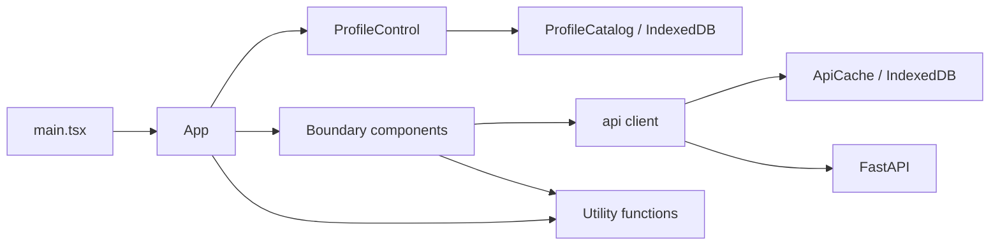

# Frontend Class and Component Reference

- **Version:** 1.0
- **Date:** 27 October 2026
- **Scope:** `SGPropertyFinder/frontend/src`
- **Purpose:** document the frontend classes, boundary components, props, design intent and usage so the React implementation can be traced from the design class diagram, sequence diagrams and dialog map.
- **Related documents:** `README.md`, `FRONTEND.md`, `FILE_REFERENCE.md`, `SPECIFICATIONS.md`.

---

## 1. How to read this reference

- React function components are documented as **boundary classes**; their public API is their props.
- **Intent** explains the component’s role in the UI.
- **Props** lists the inputs and callbacks other components provide.
- **Events / behaviour** describes what the component does and what it calls.
- Classes with real methods (`ProfileControl`, `ProfileCatalog`, `ApiCache`) include signatures and return values.

### Frontend architecture



The frontend follows the same ECB-style split used by the backend:

- **Boundary:** `src/boundary/*.tsx`
- **Control:** `src/control/ProfileControl.ts`
- **Container:** `src/container/ProfileCatalog.ts`, `src/container/ApiCache.ts`
- **Entity/DTO:** `src/types/dto.ts`
- **API contracts:** `src/api/contracts.ts`
- **API client:** `src/api/client.ts`
- **Utilities:** `src/utils/*`

---

## 2. Application shell

### `App`

- **Location:** `src/App.tsx`
- **Type:** default React component.
- **Intent:** own application state and orchestrate data loading, ranking, plan management, map/results selection, factsheets, comparison, export and notifications.
- **Props:** none (top-level component).

Key internal actions (public behaviour within the UI):

| Action | Purpose |
| --- | --- |
| `runRanking(profile)` | Calls the ranking API, stores the recommendation set and clears map/result selection. |
| `handleSaved(profileId)` | Refreshes local profiles, activates the saved plan and reruns ranking. |
| `handleSelectProfile(id)` | Activates a saved plan and reruns ranking. |
| `handleDeleteProfile(id)` | Deletes a plan and activates the next one if needed. |
| `handleRefreshData()` | Calls `/data/refresh`, reloads amenities/status and reruns the active ranking. |
| `selectSubzone(id)` | Selects an available subzone; unavailable subzones show the red bottom notice and clear prior selection. |
| `openFactsheet(id)` | Opens a factsheet for an available subzone; otherwise shows the insufficient-data notice. |
| `toggleComparison(id)` | Adds/removes an available subzone, with a four-item cap. |
| `openComparison()` | Opens the comparison matrix when at least two subzones are selected. |
| `openExport()` | Opens the PDF/share modal when a plan is active. |

**Usage:** `main.tsx` mounts `<App />`; App passes API capabilities and callbacks down to boundary components.

### `main.tsx`

- **Location:** `src/main.tsx`
- **Intent:** React entry point; imports Leaflet CSS and global styles and mounts App under StrictMode.
- **Usage:** loaded by `index.html`.

---

## 3. Boundary components

Boundary components render UI and call callbacks/API contracts. They do not own persistent data.

### `ProfileFormUI`

- **Location:** `src/boundary/ProfileFormUI.tsx`
- **Intent:** create/edit a preference plan: budget, flat types, workplace address, commute mode, five hard minimums and 1–10 importance ratings.
- **Props:**

| Prop | Type | Purpose |
| --- | --- | --- |
| `profileControl` | `ProfileControl` | Creates/updates the profile after validation. |
| `addressSearchApi` | `AddressSearchApi` | OneMap address search. |
| `criteria` | `CriterionDefinitionDTO[]` | Criterion catalogue for importance sliders. |
| `initialProfile` | `ProfileDTO \| null \| undefined` | Existing plan when editing. |
| `onSaved` | `(profileId: string) => void \| Promise<void>` | Called after save/update. |
| `onCancel` | `() => void` | Close the modal. |
| `onNotify` | `(title, message) => void` | Show validation/API notices. |

**Behaviour:** validates address selection and minimum counts, calls `createProfile`/`updateProfile`, shows `ProfileValidationError` field messages and prevents save on failure.

### `ProfileSelectorUI`

- **Location:** `src/boundary/ProfileSelectorUI.tsx`
- **Intent:** top-right saved-plan picker with per-row Edit/Delete.
- **Props:**

| Prop | Type | Purpose |
| --- | --- | --- |
| `profiles` | `ProfileDTO[]` | Saved plans. |
| `activeProfileId` | `string \| null` | Current plan. |
| `busy` | `boolean` | Disables actions while ranking. |
| `onSelect` | `(profileId) => void` | Activate a plan. |
| `onEdit` | `(profileId) => void` | Open edit modal. |
| `onDelete` | `(profileId) => Promise<void> \| void` | Delete after confirmation. |

**Behaviour:** closes on outside click/Escape, confirms deletion, and disables delete when only one plan remains.

### `ResultsListUI`

- **Location:** `src/boundary/ResultsListUI.tsx`
- **Intent:** render ranked subzone cards and comparison/factsheet/export actions.
- **Props:**

| Prop | Type | Purpose |
| --- | --- | --- |
| `recommendationSet` | `RecommendationSetDTO \| null` | Ranked results. |
| `selectedSubzoneId` | `string \| null` | Card/map synchronization. |
| `comparisonIds` | `string[]` | Selected comparison items. |
| `unavailableSubzoneIds` | `string[]` | Defensive guard for insufficient-data cards. |
| `loading` | `boolean` | Show ranking progress. |
| `onSelect` | `(subzoneId) => void` | Select card on map. |
| `onToggleCompare` | `(subzoneId) => void` | Add/remove comparison. |
| `onOpenComparison` | `() => void` | Open matrix. |
| `onOpenFactsheet` | `(subzoneId) => void` | Open factsheet. |
| `onExport` | `() => void` | Open PDF export. |
| `exportDisabled` | `boolean` | Disable export when no active plan. |

**Behaviour:** shows top-20 cards, warning count and comparison count. For unavailable cards, the factsheet button is replaced by an **“Insufficient data”** label and Compare is disabled.

### `NeighborhoodMapUI`

- **Location:** `src/boundary/NeighborhoodMapUI.tsx`
- **Intent:** Leaflet/React-Leaflet map with OneMap tiles, subzone choropleth, route overlay, refresh control and nearby amenity markers.
- **Props:**

| Prop | Type | Purpose |
| --- | --- | --- |
| `mapData` | `MapDataDTO \| null` | GeoJSON and centre. |
| `scores` | `Record<string, number>` | Subzone score colours. |
| `selectedSubzoneId` | `string \| null` | Highlighted subzone. |
| `highlightedSubzoneIds` | `string[]` | Shared-link highlights. |
| `unavailableSubzoneIds` | `string[]` | Muted/dashed unavailable polygons. |
| `amenities` | `AmenityPointDTO[]` | Nearby points for selected subzone. |
| `route` | `RouteDataDTO \| null` | Commute overlay. |
| `routeOrigin` / `routeDestination` | `CoordinatesDTO \| null` | Route endpoints. |
| `onSelect` | `(subzoneId) => void` | Polygon click. |
| `onRefresh` | `() => void` | Data refresh button. |
| `refreshing` | `boolean` | Disable refresh while busy. |

**Behaviour:** unavailable polygons are grey/dashed with an “Insufficient data” tooltip; clicks route through App’s guard. Amenity categories can be toggled and are shown only for the selected subzone.

### `FactSheetUI`

- **Location:** `src/boundary/FactSheetUI.tsx`
- **Intent:** modal factsheet for one subzone.
- **Props:** `subzoneCode` (`string | null`), `profile` (`ProfileDTO`), `detailsApi` (`NeighborhoodDetailsApi`), `onClose`, `onNotify`.
- **Behaviour:** fetches the factsheet, renders pricing per flat type, town-proxy note, environment, grouped amenities, commute details and warnings. Shows loading/error states.

### `ComparisonUI`

- **Location:** `src/boundary/ComparisonUI.tsx`
- **Intent:** side-by-side matrix for 2–4 subzones.
- **Props:** `open`, `profile`, `subzoneCodes`, `comparisonApi`, `onClose`, `onNotify`.
- **Behaviour:** fetches comparison data when opened with at least two codes; renders overall score, commute, pricing, environment, schools, hospitals, malls and MRT rows.

### `ExportReportUI`

- **Location:** `src/boundary/ExportReportUI.tsx`
- **Intent:** generate/download a PDF and copy the shareable URL.
- **Props:** `open`, `profile`, `recommendationSet`, `subzoneCodes`, `reportApi`, `onClose`, `onNotify`.
- **Behaviour:** chooses selected codes or the first three recommendations, calls `generatePdfReport`, downloads through `downloadReport`, shows expiry and copies the share URL.

### `NotificationModalUI`

- **Location:** `src/boundary/NotificationModalUI.tsx`
- **Intent:** reusable modal for validation, missing-data and API notices.
- **Props:** `title`, `message`, `onClose`, optional `children`.
- **Behaviour:** accessible dialog, closes on backdrop click or button.

---

## 4. Control class

### `ProfileControl`

- **Location:** `src/control/ProfileControl.ts`
- **Intent:** client-side profile CRUD controller; validates through the backend before writing to IndexedDB.
- **Constructor:** `new ProfileControl(profileCatalog, validator)` where `validator` implements `ProfileValidationApi`.

| Method | Signature | Behaviour |
| --- | --- | --- |
| `createProfile` | `createProfile(data: ProfileDTO): Promise<string>` | Validates, assigns an ID/creation time if absent and saves to the catalog. |
| `updateProfile` | `updateProfile(profileId: string, data: ProfileDTO): Promise<boolean>` | Validates and replaces the record; returns `true`. |
| `deleteProfile` | `deleteProfile(profileId: string): Promise<boolean>` | Deletes from the catalog; returns whether an in-memory record existed. |

**Raises:** `ProfileValidationError` when the backend returns `success=false` or `isValid=false`.

### `ProfileValidationError`

- **Location:** `src/control/ProfileControl.ts`
- **Intent:** carry field-level validation errors to the form.
- **Fields:** `name = "ProfileValidationError"`, `errors: ValidationErrorDTO[]`.

**Usage:**

```text
ProfileFormUI
  -> ProfileControl.createProfile/updateProfile
  -> api.validateProfileData
  -> ProfileCatalog.saveToLocalStorage
```

---

## 5. Container classes

### `ProfileCatalog`

- **Location:** `src/container/ProfileCatalog.ts`
- **Intent:** Dexie/IndexedDB repository for saved plans; local source of truth.
- **Database:** `sgpropfinder`, table `profiles`.

| Method | Signature | Behaviour |
| --- | --- | --- |
| `saveToLocalStorage` | `saveToLocalStorage(profile): Promise<string>` | Normalises weights, sets timestamps, `put`s the record and updates the in-memory map. |
| `loadFromLocalStorage` | `loadFromLocalStorage(): Promise<ProfileDTO[]>` | Reads all records, normalises legacy weights, updates the map and sorts by creation time. |
| `deleteProfile` | `deleteProfile(profileId): Promise<boolean>` | Deletes from Dexie and the in-memory map. |
| `addProfile` | `addProfile(profile): Promise<void>` | Alias for save. |
| `getProfile` | `getProfile(profileId): Promise<ProfileDTO \| undefined>` | Checks the in-memory map, then Dexie. |
| `getAllProfiles` | `getAllProfiles(): Promise<ProfileDTO[]>` | Reloads all profiles. |
| `removeProfile` | `removeProfile(profileId): Promise<boolean>` | Alias for delete. |

**Design note:** each instance has its own in-memory map. The app uses one instance; tests that create a second reader must call `loadFromLocalStorage()` to refresh it.

### `ApiCache`

- **Location:** `src/container/ApiCache.ts`
- **Intent:** persist API envelopes with ETag/TTL metadata and degrade gracefully if IndexedDB is unavailable.
- **Database:** `sgpropfinder-api-cache`, table `responses`.
- **Entry type:** `CachedApiResponse` (`key`, `envelope`, `etag`, `storedAt`, `expiresAt`).

| Method | Signature | Behaviour |
| --- | --- | --- |
| `get` | `get(key): Promise<CachedApiResponse \| undefined>` | Reads one entry; failures return `undefined`. |
| `set` | `set(entry): Promise<void>` | Upserts an entry; cache failures are ignored. |
| `delete` | `delete(key): Promise<void>` | Removes one entry. |
| `clear` | `clear(): Promise<void>` | Clears the cache (used after data refresh). |
| `prune` | `prune(maxAgeMs = 7 days): Promise<void>` | Deletes entries older than the cutoff. |

---

## 6. API client and contracts

### `api`

- **Location:** `src/api/client.ts`
- **Type:** object implementing all API contract interfaces.
- **Intent:** centralise fetch, envelopes, caches, ETag revalidation, stale fallback and binary download.
- **Cache version:** keys use `v2:` so schema/feature changes invalidate older cached geometry/rankings.

| Method | Signature | Intended use / caching |
| --- | --- | --- |
| `getCriteria` | `getCriteria(): Promise<ApiEnvelope<CriterionDefinitionDTO[]>>` | Criterion catalogue, 24-hour TTL. |
| `getAmenities` | `getAmenities(): Promise<ApiEnvelope<AmenityPointDTO[]>>` | Map points, 1-hour TTL. |
| `searchAddress` | `searchAddress(query): Promise<ApiEnvelope<AddressMatchDTO[]>>` | Workplace search, no cache. |
| `validateProfileData` | `validateProfileData(profile): Promise<ApiEnvelope<ValidationResultDTO>>` | Authoritative validation, no cache. |
| `decodeShare` | `decodeShare(share): Promise<ApiEnvelope<ShareScenarioDTO>>` | Import shared scenario. |
| `generateRankedRecommendations` | `generateRankedRecommendations(profile): Promise<ApiEnvelope<RecommendationSetDTO>>` | Ranking, 5-minute TTL. |
| `generateMapData` | `generateMapData(): Promise<ApiEnvelope<MapDataDTO>>` | Geometry endpoint wrapped as map data, 1-hour TTL. |
| `fetchSubzoneBoundary` | `fetchSubzoneBoundary(code)` | Find one feature geometry in cached map data. |
| `getCommuteOverlay` | `getCommuteOverlay(origin, destination, mode)` | Route overlay, 30-minute TTL. |
| `fetchNeighborhoodDetails` | `fetchNeighborhoodDetails(code, profile)` | Factsheet, 10-minute TTL. |
| `generatePdfReport` | `generatePdfReport(profile, codes)` | Generate PDF, no cache. |
| `compare` | `compare(profile, codes)` | Comparison matrix, 5-minute TTL. |
| `getStatus` | `getStatus()` | Data freshness. |
| `refreshData` | `refreshData()` | Force refresh and clear API cache. |

### `downloadReport(report: PdfReportDTO): Promise<void>`

- **Location:** `src/api/client.ts`
- **Intent:** fetch the PDF URL, create a temporary object URL and trigger a browser download.
- **Raises:** `ApiRequestError("The report download link has expired.", "REPORT_EXPIRED")` when the response is not OK.

### `requireData<T>(envelope): T`

- **Location:** `src/api/client.ts`
- **Intent:** unwrap a successful envelope or throw `ApiRequestError` using the envelope error code and retryable flag.
- **Usage:** all components use this after API calls to keep error handling consistent.

### `ApiRequestError`

- **Location:** `src/api/client.ts`
- **Intent:** typed client error.
- **Fields:** `name`, `code`, `retryable`.
- **Usage:** `try/catch` blocks pass `error.message` to `onNotify`.

### API contract interfaces

- **Location:** `src/api/contracts.ts`
- **Intent:** decouple components from the concrete client and make them testable with stubs.
- **Interfaces:** `CriteriaApi`, `AddressSearchApi`, `ProfileValidationApi`, `RankingApi`, `AmenitiesApi`, `MapApi`, `NeighborhoodDetailsApi`, `ReportApi`, `ShareApi`, `DataStatusApi`, `ComparisonApi`.
- **Usage:** components accept the smallest interface they need (e.g. `ProfileFormUI` accepts `AddressSearchApi`).

---

## 7. Types and DTOs — `src/types/dto.ts`

These interfaces mirror backend envelopes and transport payloads. They are intentionally separate from domain classes.

| Group | Key types | Usage |
| --- | --- | --- |
| Profile | `ProfileDTO`, `CriterionWeightDTO`, `ValidationResultDTO`, `ValidationErrorDTO` | Form and profile control. |
| Recommendations | `RecommendationSetDTO`, `RecommendationItemDTO`, `CriterionScoreDTO` | Results list/map scores. |
| Factsheet | `NeighborhoodDetailDTO`, `HousePricingDTO`, `AmenityInfoDTO`, `EnvironmentInfoDTO`, `CommuteEstimateDTO`, `SubzoneIndicatorsDTO` | Factsheet and comparison. |
| Map/route | `MapDataDTO`, `RouteDataDTO`, `CoordinatesDTO`, `AmenityPointDTO` | Leaflet and route overlays. |
| Reports | `PdfReportDTO`, `ReportResponseDTO` | PDF modal/downloads. |
| Envelopes/warnings | `ApiEnvelope<T>`, `ApiErrorDTO`, `DataAvailabilityWarningDTO`, `DataStatusMapDTO`, `ShareScenarioDTO` | Client and cache layer. |

---

## 8. Utility functions

### `src/utils/amenities.ts`

| Function | Signature | Purpose |
| --- | --- | --- |
| `groupAmenitiesByCategory` | `(amenities, visibleGroups?)` | Group nearby points for the factsheet. |
| `distanceKm` | `(lat1, lon1, lat2, lon2)` | Haversine distance. |
| `nearbyAmenities` | `(amenities, center, radiusKm?)` | Filter points within 2 km. |
| `filterAmenities` | `(amenities, nearbyOnly, visibleGroups)` | Apply category toggles. |
| `amenityColor` | `(category) => string` | Category colour. |

### `src/utils/format.ts`

| Function | Signature | Purpose |
| --- | --- | --- |
| `formatPrice` | `(value) => string` | Currency display. |
| `formatNumber` | `(value, digits = 0) => string` | Numeric display with em dash fallback. |
| `formatDate` | `(value) => string` | Local date/time display. |
| `scoreColor` | `(score) => string` | Choropleth colour bands. |

### `src/utils/polyline.ts`

- `decodePolyline(encoded) -> LatLngTuple[]` — decode OneMap/Google route geometry for Leaflet.

### `src/utils/subzones.ts`

- `unavailableSubzoneIds(mapData) -> string[]` — read `dataAvailable=false` flags from GeoJSON; includes a 13-code fallback for old cached geometry.

### `src/utils/weights.ts`

| Function | Signature | Purpose |
| --- | --- | --- |
| `clampImportance` | `(value) => number` | Clamp to 1–10; non-finite values become 5. |
| `importanceFromProfile` | `(weights, criterionIds) => Record<string, number>` | Load ratings and migrate legacy 0–100 weights. |
| `normalizeProfileWeights` | `(profile) => ProfileDTO` | Normalise weights before persistence. |

---

## 9. Key user flows

### Create/edit a preference plan

```text
ProfileFormUI
  -> addressSearchApi.searchAddress
  -> ProfileControl.createProfile/updateProfile
     -> api.validateProfileData
     -> ProfileCatalog.saveToLocalStorage
  -> App.handleSaved
  -> App.runRanking
```

### Rank and select a subzone

```text
App.runRanking
  -> api.generateRankedRecommendations
  -> visibleRecommendations (filters unavailable subzones)
  -> ResultsListUI / NeighborhoodMapUI
  -> selectSubzone(id)
     available: set selected id + scroll to card
     unavailable: clear selection, show red bottom notice
```

### Factsheet / comparison

```text
Available subzone selected
  -> openFactsheet(id)
  -> FactSheetUI -> api.fetchNeighborhoodDetails
  -> or toggleComparison(id) up to 4
  -> ComparisonUI -> api.compare
```

### Export PDF and share

```text
openExport
  -> ExportReportUI
  -> api.generatePdfReport
  -> downloadReport(report)
  -> copy shareUrl
```

### Insufficient-data guard

```text
Map feature dataAvailable=false
  -> unavailableSubzoneIds(mapData)
  -> map polygon muted/dashed
  -> click: no selection, red bottom notice
  -> ResultsListUI: factsheet action replaced by “Insufficient data”
  -> Compare checkbox disabled
```

---

## 10. Design patterns and intent

| Pattern / decision | Where | Why |
| --- | --- | --- |
| Boundary/control/container split | `boundary`, `control`, `container` | Keeps rendering, workflow and persistence separate. |
| Props as component API | All boundary components | Makes components testable with stubbed APIs/callbacks. |
| API contracts | `api/contracts.ts` | Avoids coupling components to the concrete client. |
| Repository | `ProfileCatalog`, `ApiCache` | Encapsulates IndexedDB access and fallback behaviour. |
| Controller | `ProfileControl` | Enforces validation before persistence. |
| Defensive filtering | `App.visibleRecommendations`, `ResultsListUI` | Handles stale cached rankings and unavailable subzones. |
| Cache versioning | `ApiCache` keys / `v2:` prefix | Invalidates old API shapes after schema changes. |
| Explicit notifications | `NotificationModalUI`, bottom toast | Distinguishes actionable errors from simple insufficient-data notices. |

---

## 11. Testing hooks

- `ProfileControl.test.ts` — black-box profile lifecycle.
- `ResultsListUI.test.tsx` — ranked cards, warning counts and insufficient-data label.
- `ProfileFormUI.test.tsx` — hard-minimum submission.
- `ProfileSelectorUI.test.tsx` — plan selection, edit/delete confirmation and one-plan guard.
- `ApiCache.test.ts` — cache persistence/pruning.
- `client.test.ts` — cache reuse, refresh invalidation and stale fallback.
- `utils/*.test.ts` — formatting, weights, amenities, polyline and unavailable-subzone extraction.

Run with:

```powershell
cd SGPropertyFinder/frontend
npm test
npm run build
```
