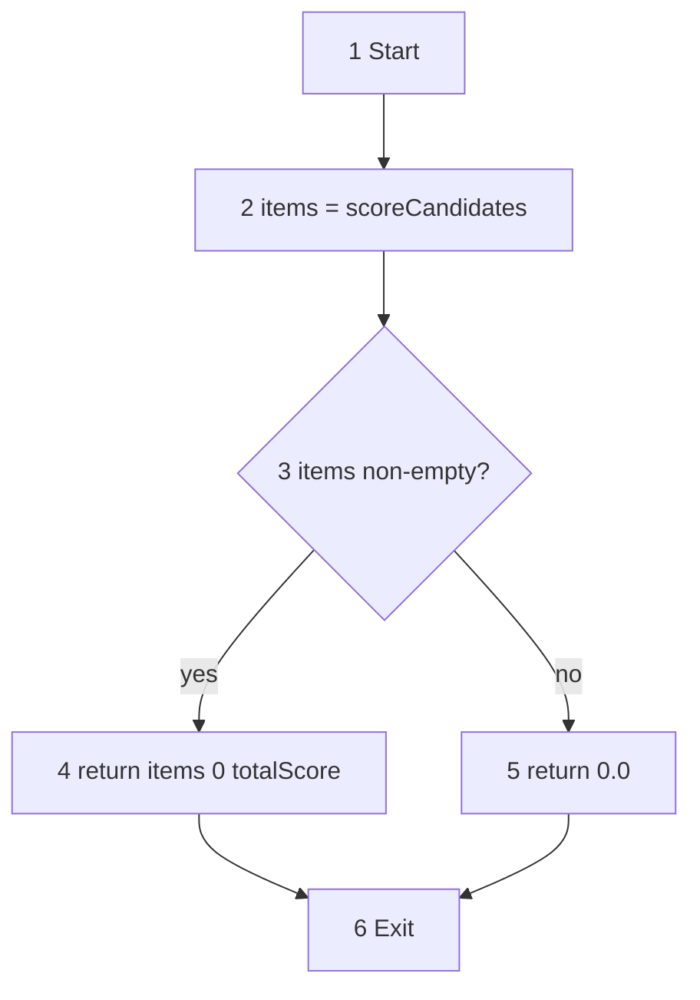
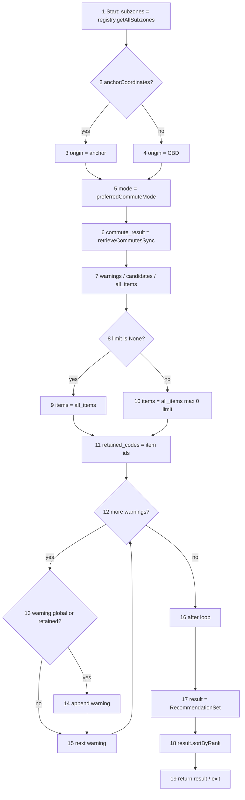

# Formal White-Box Testing

- **Version:** 2.0
- **Date:** 26 October 2026
- **Units under test:**
  - `WeightedScoringStrategy.computeSuitabilityScore` — control flow
  - `RankingControl.generateRankedRecommendations` — control flow
  - `WeightedScoringStrategy.scoreCandidates` — supporting data flow
- **Test suite:** `backend/tests/test_white_box.py`
- **Execution:** `python -m unittest tests.test_white_box -v`
- **Result:** **16 tests — all passed**

---

## 1. Objective

Apply structural testing to the scoring and ranking units:

1. derive a control-flow graph (CFG) for each primary unit;
2. calculate cyclomatic complexity `V(G)`;
3. identify a basis set of independent paths and implement tests for every path;
4. derive definition-use (DU) pairs for local variables and method parameters;
5. implement data-flow tests that exercise those definitions and uses;
6. record expected and actual results using Name, Location, Input, Oracle and
   Log.

The control-flow work proves every decision outcome executes. The data-flow
work proves values move from their definitions to the places that consume them,
including the ranking → scoring boundary.

## 2. Scope and assumptions

### In scope

- `WeightedScoringStrategy.computeSuitabilityScore` — CFG and DU analysis.
- `RankingControl.generateRankedRecommendations` — CFG and DU analysis.
- `WeightedScoringStrategy.scoreCandidates` — DU analysis for the decision-
  relevant variables (`eligible`, `raw_by_criterion`, `commute`, `raw`,
  `warning_list`, `available_weight`, `raw_rows`, `normalised`,
  `renormalised_weight`, `items`).

### Out of scope

- A statement-by-statement CFG for `scoreCandidates`; its full CFG is large and
  is represented here through data-flow pairs and behavioural tests. Its control
  decisions are exercised by `test_scoring_ranking.py` and the new data-flow
  tests.
- Exception paths. The analysed methods do not catch exceptions; failures
  propagate to the caller and do not create additional internal decisions.
- Performance, concurrency and external I/O failures.

### Graph conventions

- One node per statement group or predicate.
- `V(G) = E − N + 2P`, where `P` is the number of connected components
  (`P=1` for each method).
- Equivalent form: `V(G) = number of predicate nodes + 1`.
- List comprehensions are expanded into a loop-header node, a filter-predicate
  node, an append node and a back-edge.

## 3. Levels of testing

The white-box suite is a **unit-test** suite: each method is exercised in
isolation with deterministic stubs. Where a method crosses a collaborator
boundary (`RankingControl` → commute control → scoring strategy), the new
data-flow tests use recording stubs, which makes them **integration-style unit
tests** at that seam. They do not replace the system/acceptance evidence in
`PHASE5_E2E_CHECKLIST.md`.

| Level | White-box evidence |
| --- | --- |
| **Unit** | CFG/basis-path tests for `computeSuitabilityScore` and `generateRankedRecommendations`; DU tests for `scoreCandidates`. |
| **Integration** | `WB-DF-RR-01/02/03` record the values passed from ranking to a scoring stub; `test_scoring_ranking.py` exercises the real strategy with fixture controls. |
| **System** | `PHASE5_E2E_CHECKLIST.md` and `SLA_BENCHMARK.md`. |
| **Acceptance** | Eighteen user-journey checks in `PHASE5_E2E_CHECKLIST.md`. |

## 4. Unit 1 control flow — `computeSuitabilityScore`

### 4.1 Source

```python
items = self.scoreCandidates([subzone], profile, {subzone.subzoneCode: commute})
return items[0].totalScore if items else 0.0
```

### 4.2 Control-flow graph



| Node | Statement |
| --- | --- |
| 1 | Enter method |
| 2 | Call `scoreCandidates` with a one-candidate cohort |
| 3 | Predicate: `items` is truthy |
| 4 | Return `items[0].totalScore` |
| 5 | Return `0.0` |
| 6 | Exit |

### 4.3 Cyclomatic complexity

| Metric | Value |
| --- | --- |
| Nodes `N` | 6 |
| Edges `E` | 6 |
| Connected components `P` | 1 |
| Predicate nodes | 1 (`items` truthy) |
| `V(G)` | `6 − 6 + 2 = 2` |

### 4.4 Basis paths

| Path | Node sequence | Condition |
| --- | --- | --- |
| BP-CSS-1 | 1 → 2 → 3 → 4 → 6 | `scoreCandidates` returns at least one item |
| BP-CSS-2 | 1 → 2 → 3 → 5 → 6 | `scoreCandidates` returns an empty list |

Both paths are feasible.

### 4.5 Basis-path tests

Location abbreviation: `WB` = `backend/tests/test_white_box.py`.

| ID | Name | Location | Input | Oracle | Log | Status |
| --- | --- | --- | --- | --- | --- | --- |
| WB-CSS-01 | Non-empty items returns total score | `WB::ComputeSuitabilityScoreWhiteBoxTests::test_wb_css_01_non_empty_items_returns_total_score` | Fixture subzone, valid profile, 20-minute commute | Return equals `scoreCandidates(...)[0].totalScore`; value in `[0, 100]` | `score == expected; 0 <= score <= 100` | Pass |
| WB-CSS-02 | Empty items returns zero | `WB::ComputeSuitabilityScoreWhiteBoxTests::test_wb_css_02_empty_items_returns_zero` | Same candidate; `minimumPrimarySchools=2` removes it | `0.0` | `0.0` | Pass |

## 5. Unit 2 control flow — `generateRankedRecommendations`

### 5.1 Source structure

The method:

1. loads all subzones;
2. chooses the profile anchor or falls back to the CBD;
3. retrieves commute estimates synchronously;
4. scores every candidate;
5. applies the optional result limit;
6. retains warnings whose `subzoneCode` is global (`None`) or belongs to a
   retained item;
7. builds, sorts and returns a `RecommendationSet`.

The warning filter is a list comprehension and is expanded in the CFG because
it affects which warnings reach the result.

### 5.2 Control-flow graph



| Node | Statement group |
| --- | --- |
| 1 | Import `RecommendationSet`; `subzones = getAllSubzones()` |
| 2 | Predicate: `profile.anchorCoordinates` truthy |
| 3 | `origin = profile.anchorCoordinates` |
| 4 | `origin = Coordinates(CBD_LATITUDE, CBD_LONGITUDE)` |
| 5 | `mode = profile.preferredCommuteMode` |
| 6 | `commute_result = retrieveCommutesSync(...)` |
| 7 | `warnings = list(...)`; `candidates = subzones`; `all_items = scoreCandidates(...)` |
| 8 | Predicate: `limit is None` |
| 9 | `items = all_items` |
| 10 | `items = all_items[:max(0, limit)]` |
| 11 | `retained_codes = {item.subzoneId ...}` |
| 12 | Loop header: `for warning in warnings` |
| 13 | Filter predicate: `warning.subzoneCode is None or warning.subzoneCode in retained_codes` |
| 14 | Append warning to filtered list |
| 15 | Advance to next warning |
| 16 | After-loop warning list |
| 17 | Build `RecommendationSet` |
| 18 | `result.sortByRank()` |
| 19 | Return result / exit |

### 5.3 Cyclomatic complexity

| Metric | Value |
| --- | --- |
| Nodes `N` | 19 |
| Edges `E` | 22 |
| Connected components `P` | 1 |
| Predicate nodes | 4 (anchor, limit, loop, warning filter) |
| `V(G)` | `22 − 19 + 2 = 5` |

### 5.4 Basis paths

| Path | Predicate outcomes | Node sequence |
| --- | --- | --- |
| BP-RR-1 | anchor yes; limit None; loop entered; warning kept | 1-2-3-5-6-7-8-9-11-12-13-14-15-12-16-17-18-19 |
| BP-RR-2 | anchor no; limit None; loop entered; warning kept | 1-2-4-5-6-7-8-9-11-12-13-14-15-12-16-17-18-19 |
| BP-RR-3 | anchor yes; limit numeric; loop entered; warning kept | 1-2-3-5-6-7-8-10-11-12-13-14-15-12-16-17-18-19 |
| BP-RR-4 | anchor yes; limit None; loop entered; warning dropped | 1-2-3-5-6-7-8-9-11-12-13-15-12-16-17-18-19 |
| BP-RR-5 | anchor yes; limit None; loop not entered | 1-2-3-5-6-7-8-9-11-12-16-17-18-19 |

All five paths are feasible and are covered by the tests below.

### 5.5 Basis-path tests

| ID | Name | Location | Input | Oracle | Log | Status |
| --- | --- | --- | --- | --- | --- | --- |
| WB-RR-01 | Anchor, no limit, retained warnings | `WB::GenerateRankedRecommendationsWhiteBoxTests::test_wb_rr_01_anchor_limit_none_keeps_retained_warnings` | Anchor present; `limit=None`; global + retained + unknown warnings | 3 items; origin = anchor; warnings `[None, TAMPINES01]`; snapshot `WB-SNAPSHOT` | `items=3; origin=anchor; warnings=[None,TAMPINES01]; snapshot=WB-SNAPSHOT` | Pass |
| WB-RR-02 | Missing anchor uses CBD | `WB::GenerateRankedRecommendationsWhiteBoxTests::test_wb_rr_02_missing_anchor_uses_cbd` | Anchor `None`; retained warning | Origin = CBD; 3 items; warning kept | `origin=(1.283,103.8513); items=3; warnings=[TAMPINES01]` | Pass |
| WB-RR-03 | Numeric limit slices items | `WB::GenerateRankedRecommendationsWhiteBoxTests::test_wb_rr_03_non_none_limit_slices_items` | Anchor present; `limit=3`; retained warning | 3 items; warning kept | `items=3; warnings=[TAMPINES01]` | Pass |
| WB-RR-04 | Unretained warning dropped | `WB::GenerateRankedRecommendationsWhiteBoxTests::test_wb_rr_04_unretained_warning_is_dropped` | Warning for `UNKNOWN` | Warning dropped; warnings empty | `warnings=[]` | Pass |
| WB-RR-07 | Empty warnings skip loop | `WB::GenerateRankedRecommendationsWhiteBoxTests::test_wb_rr_07_empty_warnings_skip_filter_loop` | Empty warning list | 3 items; no warnings | `items=3; warnings=[]` | Pass |

### 5.6 Supplementary boundary tests

These are not additional basis paths, but exercise the numeric-limit boundary
inside the false branch of node 8.

| ID | Name | Location | Input | Oracle | Log | Status |
| --- | --- | --- | --- | --- | --- | --- |
| WB-RR-05 | Limit zero | `WB::GenerateRankedRecommendationsWhiteBoxTests::test_wb_rr_05_limit_zero_returns_no_items` | `limit=0`; global + retained warnings | No items; only global warning retained | `items=[]; warnings=[None]` | Pass |
| WB-RR-06 | Negative limit | `WB::GenerateRankedRecommendationsWhiteBoxTests::test_wb_rr_06_negative_limit_is_clamped_to_zero` | `limit=-5` | `max(0, limit)` produces no items | `items=[]` | Pass |

## 6. Data-flow testing

### 6.1 Definitions, uses and coverage criteria

- **def**: a statement assigns a value to a variable.
- **c-use**: a computational use of the value (calculation, call argument,
  return value).
- **p-use**: a predicate use of the value in a decision.
- A **DU pair** is a definition and a reachable use.

The suite targets three data-flow criteria:

1. **All-defs** — every definition reaches at least one use.
2. **All-c-uses** — every definition reaches every reachable computational use.
3. **All-p-uses** — every definition reaches every reachable predicate use, and
   both outcomes are exercised where feasible.

`definition is None` at `scoreCandidates` line 138 is documented as infeasible
with the frozen criterion catalogue: every `criterion_id` originates from that
catalogue. Exception paths are out of scope.

### 6.2 DU pairs — `computeSuitabilityScore`

| Pair | Variable | Definition | Use | Kind | Covered by |
| --- | --- | --- | --- | --- | --- |
| DF-CSS-01 | `subzone` | Parameter entry | Line 34: list element and dict key | c-use | WB-CSS-01 |
| DF-CSS-02 | `profile` | Parameter entry | Line 34: passed to `scoreCandidates` | c-use | WB-CSS-01 |
| DF-CSS-03 | `commute` | Parameter entry | Line 34: dict value | c-use | WB-CSS-01 |
| DF-CSS-04 | `items` | Line 34 | Line 35: truthiness predicate | p-use | WB-CSS-01/02 |
| DF-CSS-05 | `items` | Line 34 | Line 35: `items[0]` | c-use | WB-CSS-01 |

### 6.3 DU pairs — `generateRankedRecommendations`

Line numbers refer to `backend/app/control/ranking_control.py`.

| Pair | Variable | Definition | Use | Kind | Covered by |
| --- | --- | --- | --- | --- | --- |
| DF-RR-01 | `subzones` | 64 | 67: commute call argument | c-use | WB-RR-01/02, WB-DF-RR-01 |
| DF-RR-02 | `subzones` | 64 | 78: scoring candidate cohort | c-use | All RR tests |
| DF-RR-03 | `origin` | 65 | 68: commute call argument | c-use | WB-RR-01/02, WB-DF-RR-01 |
| DF-RR-04 | `mode` | 66 | 70: commute call argument | c-use | All RR tests |
| DF-RR-05 | `commute_result` | 67 | 74: warnings | c-use | All RR tests |
| DF-RR-06 | `commute_result` | 67 | 82: commute data | c-use | All RR tests |
| DF-RR-07 | `warnings` | 74 | 80: scoring warning argument | c-use | WB-RR-01/04, WB-DF-RR-01 |
| DF-RR-08 | `warnings` | 74 | 87: filter input | c-use | WB-RR-01/04, WB-DF-RR-01 |
| DF-RR-09 | `candidates` | 78 | 80: scoring candidate argument | c-use | All RR tests |
| DF-RR-10 | `all_items` | 79 | 85: `limit is None` branch | c-use | WB-RR-01/02/04/07 |
| DF-RR-11 | `all_items` | 79 | 85: numeric-limit slice | c-use | WB-RR-03/05/06 |
| DF-RR-12 | `items` | 85 | 86: retained codes | c-use | All RR tests |
| DF-RR-13 | `items` | 85 | 97: result items | c-use | All RR tests |
| DF-RR-14 | `retained_codes` | 86 | 90: warning filter predicate | p-use | WB-RR-01/04/05, WB-DF-RR-02 |
| DF-RR-15 | `result` | 92 | 101: `sortByRank` | c-use | All RR tests |
| DF-RR-16 | `result` | 92 | 102: return | c-use | All RR tests |
| DF-RR-17 | `profile` | Parameter entry | 65: anchor predicate | p-use | WB-RR-01/02 |
| DF-RR-18 | `profile` | Parameter entry | 81: scoring argument | c-use | All RR tests |
| DF-RR-19 | `profile` | Parameter entry | 93/99: ID and snapshot | c-use | All RR tests, WB-DF-RR-01 |
| DF-RR-20 | `limit` | Parameter entry | 85: `limit is None` predicate | p-use | WB-RR-01/03/05/06 |
| DF-RR-21 | `warning` | 89: loop variable | 90: filter predicate | p-use | WB-RR-01/04, WB-DF-RR-01 |
| DF-RR-22 | `warning` | 89: loop variable | 88: output expression | c-use | WB-RR-01/04, WB-DF-RR-01 |
| DF-RR-23 | `item` | 86: comprehension variable | 86: `item.subzoneId` | c-use | All RR tests |

### 6.4 DU pairs — `scoreCandidates` (supporting unit)

Line numbers refer to `backend/app/strategy/weighted_scoring_strategy.py` after
the dead-store cleanup described in section 8.

| Pair | Variable | Definition | Use | Kind | Covered by |
| --- | --- | --- | --- | --- | --- |
| DF-SC-01 | `warning_list` | 50 | 96: missing-data warning append | c-use | WB-DF-SC-03 |
| DF-SC-02 | `warning_list` | 50 | 112: no-available-criteria warning append | c-use | WB-DF-SC-04 |
| DF-SC-03 | `eligible` | 51 | 77: raw-value collection loop | c-use | WB-DF-SC-01 |
| DF-SC-04 | `eligible` | 51 | 85: item-building loop | c-use | All scoring tests |
| DF-SC-05 | `raw_by_criterion` | 74 | 92: criterion value lookup | c-use | All scoring tests |
| DF-SC-06 | `raw_by_criterion` | 74 | 141: fixed-domain normalisation | c-use | All scoring tests |
| DF-SC-07 | `commute` | 78 | 79: raw-value argument | c-use | WB-DF-SC-02 |
| DF-SC-08 | `raw` | 79 | 80: `raw is not None` predicate | p-use | WB-DF-SC-02 (true/false) |
| DF-SC-09 | `raw` | 93 | 94: `raw is None` predicate | p-use | WB-DF-SC-02 (true/false) |
| DF-SC-10 | `available_weight` | 87 | 111: `available_weight <= 0` predicate | p-use | WB-DF-SC-04 (true), other tests (false) |
| DF-SC-11 | `raw_rows` | 88 | 123: criterion-score loop | c-use | All scoring tests |
| DF-SC-12 | `normalised` | 140 | 144: weighted contribution | c-use | All scoring tests |
| DF-SC-13 | `renormalised_weight` | 143 | 151: score row | c-use | All scoring tests |
| DF-SC-14 | `items` | 84 | 168/178: sort and return | c-use | All scoring tests |

### 6.5 Data-flow test cases

| ID | Name | Location | Input | Oracle | Log | Status |
| --- | --- | --- | --- | --- | --- | --- |
| WB-DF-SC-01 | Eligible guards raw-value collection | `WB::ScoringDataFlowWhiteBoxTests::test_wb_df_sc_01_eligible_definition_guards_raw_value_collection` | Budget `450000`; all three fixture subzones | Only BEDOK01/JURONG01 scored; TAMPINES01 never reaches `_rawValue` | `items={BEDOK01,JURONG01}; TAMPINES01 not in raw calls` | Pass |
| WB-DF-SC-02 | Missing commute reaches missing criterion | `WB::ScoringDataFlowWhiteBoxTests::test_wb_df_sc_02_missing_commute_definition_reaches_missing_criterion` | Commute dict omits JURONG01 | JURONG01 `COMMUTE_TIME` is missing; remaining weights sum to 1.0; raw call sees `None` | `COMMUTE_TIME missing; raw=(COMMUTE_TIME,JURONG01,None); weights sum=1.0` | Pass |
| WB-DF-SC-03 | Warning list is mutated by missing data | `WB::ScoringDataFlowWhiteBoxTests::test_wb_df_sc_03_warning_list_definition_is_mutated_by_missing_data` | JURONG01 green coverage `None`; caller supplies `warnings=[]` | Caller's list receives a GREEN_COVERAGE warning for JURONG01 | `warnings contains JURONG01/GREEN_COVERAGE` | Pass |
| WB-DF-SC-04 | Zero available weight skips item and warns | `WB::ScoringDataFlowWhiteBoxTests::test_wb_df_sc_04_zero_available_weight_skips_item_and_warns` | TAMPINES01 all criteria missing; no commute | No item; `SCORING` warning says no positive weight/data | `items=[]; SCORING warning present` | Pass |
| WB-DF-RR-01 | Inputs flow from retrieval to scoring and result | `WB::RankingDataFlowWhiteBoxTests::test_wb_df_rr_01_inputs_flow_from_retrieval_to_scoring_and_result` | Anchor; two commute estimates; global + retained warnings; two stub items | Commute call gets origin/mode/subzones; scoring gets profile, commute data, warnings; result keeps items, snapshot and retained warnings | `3 boundary calls recorded; items=[BEDOK01,TAMPINES01]; snapshot=profile-1` | Pass |
| WB-DF-RR-02 | Limit and retained codes filter warnings | `WB::RankingDataFlowWhiteBoxTests::test_wb_df_rr_02_limit_and_retained_codes_filter_warnings` | `limit=1`; warnings for global, TAMPINES01 and BEDOK01 | Only TAMPINES01 item and its warning survive; BEDOK01 warning dropped | `items=[TAMPINES01]; warnings=[None,TAMPINES01]` | Pass |
| WB-DF-RR-03 | Compute passes arguments to candidates | `WB::RankingDataFlowWhiteBoxTests::test_wb_df_rr_03_compute_passes_arguments_to_candidates` | Recording strategy returns one item with `totalScore=77.7` | Score `77.7`; one-candidate list; commute map; same profile object | `score=77.7; subzones=[TAMPINES01]; commutes={TAMPINES01:20min}` | Pass |

### 6.6 Data-flow coverage summary

| Unit | All-defs | All-c-uses | All-p-uses | Evidence |
| --- | --- | --- | --- | --- |
| `computeSuitabilityScore` | Yes | Yes | Yes (true/false) | WB-CSS-01/02, WB-DF-RR-03 |
| `generateRankedRecommendations` | Yes | Yes | Yes (anchor, limit, filter, loop) | WB-RR-01…07, WB-DF-RR-01/02 |
| `scoreCandidates` (listed pairs) | Yes | Yes | Yes (raw and available-weight predicates; `definition is None` infeasible) | WB-DF-SC-01…04 plus scoring tests |

## 7. Combined coverage summary

| Unit / technique | `V(G)` | Basis paths | Tests |
| --- | --- | --- | --- |
| `computeSuitabilityScore` — control flow | 2 | 2 | WB-CSS-01, WB-CSS-02 |
| `generateRankedRecommendations` — control flow | 5 | 5 + 2 boundary extras | WB-RR-01…07 |
| `scoreCandidates` — data flow | — | — | WB-DF-SC-01…04 |
| Ranking boundary — data flow | — | — | WB-DF-RR-01…03 |
| **Total** | — | **7 basis paths** | **16 tests** |

Coverage was established by test design and assertions rather than a
line-coverage tool. Every CFG node is reached by at least one basis path, every
predicate outcome is exercised where feasible, and every listed DU pair has a
covering test.

## 8. Observations and defects

**No functional defects were found in the analysed units.** One data-flow
anomaly was detected and removed:

### DF-ANOM-01 — dead store in `scoreCandidates`

The item-building loop previously contained:

```python
for subzone in eligible:
    commute = commutes.get(subzone.subzoneCode)   # defined
    criterion_scores: list[CriterionScore] = []   # never uses `commute`
```

`commute` had no reachable use in that loop, so no test could cover a use. The
assignment was removed during this testing pass. Behaviour is unchanged because
commute values are consumed in the raw-value loop and the final sort key.
Documented structural behaviours:

1. **CBD fallback.** When `profile.anchorCoordinates` is `None`, the method uses
   the CBD coordinates before calling the commute boundary.
2. **Negative and zero limits.** `max(0, limit)` prevents a negative slice;
   `limit=0` returns no recommendations while global warnings survive.
3. **Global warnings survive filtering.** Warnings with `subzoneCode=None` are
   retained even when no items survive the limit.
4. **Subzone warnings are item-bound.** A warning for a subzone outside the
   retained result is dropped after slicing.
5. **Empty scoring cohort.** `computeSuitabilityScore` returns `0.0` when hard
   filters remove the only candidate.
6. **Warning-list aliasing is intentional.** `scoreCandidates` appends missing-
   data warnings to the caller's list; the ranking control passes the commute
   warning list so both sources reach the result.
7. **Infeasible predicate branch.** `definition is None` cannot occur while
   `criterion_id` comes from the frozen criterion catalogue.

## 9. Reproduction

```powershell
cd SGPropertyFinder/backend
python -m unittest tests.test_white_box -v
```

Observed summary:

```text
Ran 16 tests in 0.040s

OK
```

Full backend regression:

```powershell
cd SGPropertyFinder
make test
```

Observed summary at the time of writing:

```text
Ran 160 tests
OK
```

Frontend regression (unchanged by white-box work):

```powershell
cd SGPropertyFinder/frontend
npm test
```

Observed summary at the time of writing:

```text
Test Files 10 passed (10)
Tests 34 passed (34)
```

## 10. Traceability

| Requirement | Evidence |
| --- | --- |
| CFG for scoring wrapper | Section 4.2 |
| CFG for ranking | Section 5.2 |
| Cyclomatic complexity | Sections 4.3 and 5.3 |
| Basis-path test-case table | Sections 4.4, 4.5, 5.4 and 5.5 |
| Definition-use tables | Sections 6.2, 6.3 and 6.4 |
| Data-flow tests | Section 6.5 |
| Deck-level test details (Name/Location/Input/Oracle/Log) | Sections 4.5, 5.5, 5.6 and 6.5 |
| Implemented tests | `backend/tests/test_white_box.py` |
| Expected/actual results | Sections 4.5, 5.5, 5.6 and 6.5 |
| Data-flow anomaly and fix | Section 8, DF-ANOM-01 |
