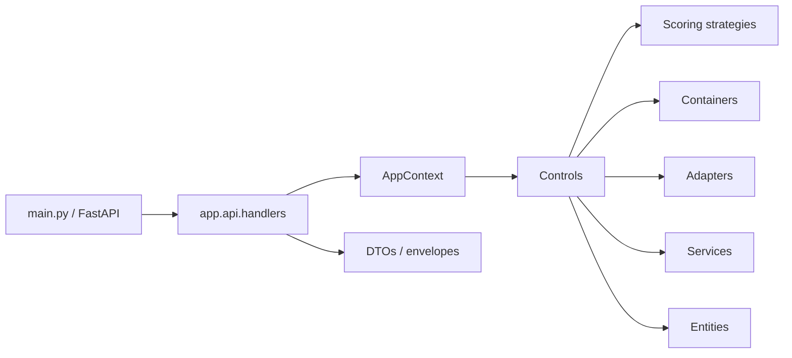

# Backend Class and Method Reference

- **Version:** 1.1
- **Date:** 8 November 2026
- **Scope:** `SGPropertyFinder/backend`
- **Purpose:** document the backend classes, their design intent, key public methods and usage so the implementation can be traced from the design class diagram and sequence diagrams.
- **Related documents:** `SPECIFICATIONS_AND_ARCHITECTURE.md`, `FILE_REFERENCE.md`, `WHITE_BOX_TESTING.md`, `BLACK_BOX_TESTING.md`, `EXTERNAL_API_DATA.md`, `LIMITATIONS.md`.

---

## 1. How to read this reference

- **Intent** states why the class exists, not just what it stores.
- **Key public methods** are the methods other layers may call. Private helpers are omitted unless they explain an important design decision.
- Signatures use Python type annotations from the implementation.
- “Raises” lists expected exceptions or error envelopes; unexpected failures are generally allowed to propagate to the API handler.
- “Usage” shows where the class fits in the application flow.

### Backend architecture



The backend follows an ECB-style split:

- **Boundary/API:** `main.py`, `app/api/handlers.py`.
- **Control:** `app/control/*`.
- **Entity:** `app/entity/*`, `app/schemas/*`.
- **Container:** `app/container/*`.
- **Adapter:** `app/adapter/*`.
- **Strategy:** `app/strategy/*`.
- **Service/utility:** `app/services/*`, `app/core/*`.

The backend is stateless except for short-lived caches and the PDF report store. User profiles live in the browser.

---

## 2. Application composition

### `AppContext`

- **Location:** `backend/app/bootstrap.py`
- **Stereotype:** composition root / service registry.
- **Intent:** hold every shared service for one backend process so handlers and tests receive dependencies explicitly instead of constructing them.
- **Key fields:** `settings`, `dataDir`, `registry`, `oneMapAdapter`, `dataGovAdapter`, `datasetService`, `notifier`, `validator`, `pricingControl`, `amenityControl`, `environmentControl`, `commuteControl`, `scoringStrategy`, `rankingControl`, `detailsControl`, `comparisonControl`, `mapControl`, `reportControl`, `reportStore`, `dataSnapshotId`, `dataAsOf`.
- **Usage:** constructed once by `buildContext()` and passed to API handlers.

### `buildContext(...) -> AppContext`

- **Location:** `backend/app/bootstrap.py`
- **Signature:** `buildContext(settings=None, dataDir=None, oneMapAdapter=None)`
- **Intent:** wire settings, adapters, controls, fixtures/data assets, registry enrichment, scoring, ranking, factsheet, map and report dependencies.
- **Behaviour:**
  - loads `subzones.geojson` through `DatasetService`;
  - loads HDB, amenity and environment assets;
  - marks subzones from `commute_matrix.json.metadata.errors` as `dataAvailable=false`;
  - creates the registry, controls, strategies and report store;
  - attaches derived pricing/amenity/environment indicators to each subzone.
- **Usage:** `main.createApp()` uses it in production; tests pass a fixture `dataDir` and a `FakeOneMap` adapter.

### `Settings`

- **Location:** `backend/app/config.py`
- **Intent:** load environment variables from `.env`/process environment without exposing secret values in logs.
- **Key method:** `Settings.fromEnv() -> Settings`
- **Important fields:** `ONEMAP_EMAIL`, `ONEMAP_PASSWORD`, `ONEMAP_BASE_URL`, `DATA_GOV_SG_*`, `APP_ENV`, `APP_HOST`, `APP_PORT`, `DATA_MAX_AGE_HOURS`.
- **Usage:** called by `buildContext()` when no settings are supplied.

### `main.createApp(context=None)`

- **Location:** `backend/main.py`
- **Intent:** create the FastAPI application, register routes, attach CORS/cache headers and define the startup data-refresh lifespan.
- **Usage:** `uvicorn main:app` for normal execution; tests call `createApp(TestContext)`.

---

## 3. API façade — `app.api.handlers`

`handlers.py` contains functions rather than classes because the HTTP layer is intentionally thin. They form the boundary between FastAPI and the controls.

### Envelope helpers

| Method | Signature | Intent / usage |
| --- | --- | --- |
| `ok` | `ok(data, warnings=None) -> ApiEnvelope[Any]` | Wrap successful data; serialises dataclasses/enums through `toJsonable`. |
| `fail` | `fail(code, message, details=None) -> ApiEnvelope[Any]` | Return a machine-readable error without raising through FastAPI. |

### Request handlers

| Handler | Signature | Returns / important behaviour |
| --- | --- | --- |
| `searchAddress` | `searchAddress(query, context)` | OneMap address matches; returns `ADDRESS_NOT_FOUND` or `ADDRESS_LOOKUP_FAILED` on failure. |
| `validateProfile` | `validateProfile(profilePayload, context)` | Parses `ProfileDTO`, calls `InputValidationControl`, returns validation errors. |
| `recommendations` | `recommendations(profilePayload, context)` | Validates the profile, ranks available subzones and returns a `RecommendationSet` with warnings. |
| `factsheet` | `factsheet(subzoneCode, profilePayload, context)` | Rejects `dataAvailable=false`; calls `NeighborhoodDetailsControl`; returns a `NeighborhoodDetailDTO`. |
| `comparison` | `comparison(profilePayload, subzoneCodes, context)` | Rejects unavailable subzones; calls `ComparisonControl`; enforces the 2–4 comparison rule. |
| `commuteOverlay` | `commuteOverlay(payload, context)` | Parses origin/destination/mode and returns a route overlay. |
| `generateReport` | `generateReport(profilePayload, subzoneCodes, context)` | Ranks, fetches factsheets, generates the PDF and returns secure download metadata plus share URL. |
| `geometry` | `geometry(context, scores=None)` | Returns the subzone FeatureCollection, including `dataAvailable` flags. |
| `criteria` | `criteria(context)` | Returns the frozen criterion catalogue used by the UI. |
| `amenities` | `amenities(context)` | Returns all amenity points for the map. |
| `dataStatus` | `dataStatus(context)` | Returns snapshot/live freshness metadata. |
| `refreshData` | `refreshData(context)` | Refreshes data.gov.sg snapshots and rebuilds amenity aggregates. |
| `reportPath` | `reportPath(reportId, context)` | Returns a valid stored PDF path or `None` if expired/missing. |
| `decodeShare` | `decodeShare(share)` | Decodes the base64 share payload into `(profile, subzoneCodes)`. |
| `decodeShareLink` | `decodeShareLink(share, context)` | Validates a share link and returns a `ProfileDTO` plus codes. |
| `health` | `health()` | Simple `{status: ok}` envelope. |
| `ready` | `ready(context)` | Readiness based on the number of loaded subzones. |

**Usage:** handlers are the seam used by both FastAPI and integration tests. They do not know about HTTP status codes; `main.py` maps envelopes to responses.

---

## 4. Controls

Controls contain application logic and coordinate entities, containers, adapters and strategies.

### `InputValidationControl`

- **Location:** `backend/app/control/input_validation_control.py`
- **Intent:** authoritative profile validation before saving or ranking.
- **Constructor:** accepts an optional OneMap adapter for address verification.
- **Key method:**

| Method | Signature | Behaviour |
| --- | --- | --- |
| `validateProfileData` | `validateProfileData(data: ProfileDTO) -> ValidationResult` | Checks name, budget ordering, flat types, workplace/anchor, address resolution, criterion IDs/rating range, hard minimums and commute mode. Returns field-level errors and `isValid`. |

**Usage:** `handlers.validateProfile` calls this; `ProfileControl` on the frontend calls the resulting endpoint before writing to IndexedDB.

### `RankingControl`

- **Location:** `backend/app/control/ranking_control.py`
- **Intent:** orchestrate commute retrieval, candidate selection, scoring, result limiting and warning filtering.
- **Constructor dependencies:** `SubzoneRegistry`, `ScoringStrategy`, `CommuteControl`, optional notifier, snapshot metadata.
- **Key method:**

| Method | Signature | Behaviour |
| --- | --- | --- |
| `generateRankedRecommendations` | `generateRankedRecommendations(profile, limit=20) -> RecommendationSet` | Selects `dataAvailable` subzones, retrieves commutes, scores candidates, applies the limit, filters warnings to retained items, builds and sorts the result. Pass `limit=None` for the full ranking used by comparison. |

**Design intent:** ranking is stateless per request; the caller supplies the profile and snapshot context.

### `ComparisonControl`

- **Location:** `backend/app/control/comparison_control.py`
- **Intent:** build a comparison result for 2–4 subzones using the full ranking and factsheet data.
- **Key method:**

| Method | Signature | Behaviour |
| --- | --- | --- |
| `compare` | `compare(profile, subzoneCodes) -> ComparisonResult` | Validates the 2–4 count, orders items by rank, fetches each factsheet, selects the best subzone and creates a summary. |

### `NeighborhoodDetailsControl`

- **Location:** `backend/app/control/neighborhood_details_control.py`
- **Intent:** aggregate pricing, amenities, environment, commute and warnings into one factsheet DTO.
- **Key method:**

| Method | Signature | Behaviour |
| --- | --- | --- |
| `fetchNeighborhoodDetails` | `fetchNeighborhoodDetails(subzoneCode, profile) -> NeighborhoodDetailDTO` | Resolves the subzone, retrieves all factsheet sections, calculates commute to the workplace, adds a pricing proxy note and returns warnings. |

### `MapControl`

- **Location:** `backend/app/control/map_control.py`
- **Intent:** prepare Leaflet payloads and route overlays.
- **Key methods:**

| Method | Signature | Behaviour |
| --- | --- | --- |
| `generateMapData` | `generateMapData(scores=None) -> MapData` | Returns the FeatureCollection, score map and map centre. |
| `fetchSubzoneBoundary` | `fetchSubzoneBoundary(subzoneCode) -> Polygon` | Returns one subzone boundary; raises `KeyError` for unknown codes. |
| `getCommuteOverlay` | `getCommuteOverlay(origin, destination, mode, departureTime=None) -> RouteData` | Calls OneMap and normalises the route summary/legs. Raises `ValueError` if no usable route. |

### `ReportControl`

- **Location:** `backend/app/control/report_control.py`
- **Intent:** generate short-lived ReportLab PDFs and browser-safe share/download metadata.
- **Constructor:** accepts a `ReportStore`, report directory, public base URL and optional clock for deterministic expiry tests.
- **Key methods:**

| Method | Signature | Behaviour |
| --- | --- | --- |
| `generatePdfReport` | `generatePdfReport(recommendations, details) -> PdfReport` | Renders the PDF, stores it with a 15-minute expiry and returns download metadata. |
| `exportToFile` | `exportToFile(report, filePath) -> bool` | Copies a still-available report; returns `False` for expired/missing reports. |
| `generateShareableUrl` | `generateShareableUrl(profile, subzoneCodes, baseUrl="/") -> str` | Base64-encodes the profile and selected codes into a `?share=` URL. |

### `CommuteControl`

- **Location:** `backend/app/control/commute_control.py`
- **Intent:** produce deterministic CBD matrix values, live OneMap routes or estimated fallbacks while keeping warnings explicit.
- **Constructor dependencies:** OneMap adapter, optional notifier, matrix path and optional TTL cache.
- **Key methods:**

| Method | Signature | Behaviour |
| --- | --- | --- |
| `isNearCbd` | `isNearCbd(origin) -> bool` | Returns whether the origin is within 1 km of Raffles Place. |
| `retrieveCommute` | `retrieveCommute(origin, destination, mode, departureTime=None, destinationSubzoneCode=None, warnings=None) -> CommuteEstimate` | Uses the cache, CBD matrix, live route or straight-line fallback in that order. |
| `retrieveCommutes` | `retrieveCommutes(origin, subzones, mode, departureTime=None, topK=50) -> RetrievalResult[dict[str, CommuteEstimate]]` | Async batch path: matrix for CBD PT, otherwise top-50 live and heuristic remainder. |
| `retrieveCommutesSync` | `retrieveCommutesSync(...) -> RetrievalResult[...]` | Synchronous wrapper used by ranking; raises `CommuteError` inside an active event loop. |

**Important property:** `insufficientDataSubzoneCodes` is parsed from `commute_matrix.json.metadata.errors`; the bootstrap marks those subzones unavailable.

### `AmenityRetrievalControl`

- **Location:** `backend/app/control/amenity_retrieval_control.py`
- **Intent:** load the amenity snapshot, count POIs within fixed radii and expose map points/status.
- **Key methods:**

| Method | Signature | Behaviour |
| --- | --- | --- |
| `fetchData` / `parseResponse` | `fetchData(resourceId)`, `parseResponse(data)` | Template-method hooks for the amenity source. |
| `retrieveAmenityInfo` | `retrieveAmenityInfo(subzoneCode) -> RetrievalResult[list[AmenityInfo]]` | Nearby amenities within 2 km, sorted by distance. |
| `getAllAmenities` | `getAllAmenities() -> RetrievalResult[list[dict]]` | All points for the map overlay. |
| `retrieveIndicators` | `retrieveIndicators(subzoneCode) -> RetrievalResult[SubzoneIndicators]` | School/health/park/mall/MRT counts and nearest distances. |
| `status` | `status() -> DatasetStatus` | Snapshot freshness and record count. |
| `rebuildFromLocalSources` | `rebuildFromLocalSources() -> DatasetStatus` | Recomputes aggregates without network calls and rewrites the snapshot. |

### `EnvironmentRetrievalControl`

- **Location:** `backend/app/control/environment_retrieval_control.py`
- **Intent:** provide deterministic regional baselines for scoring and display-only live readings.
- **Key methods:**

| Method | Signature | Behaviour |
| --- | --- | --- |
| `retrieveEnvironmentInfo` | `retrieveEnvironmentInfo(subzoneCode, includeLive=True) -> RetrievalResult[EnvironmentInfo]` | Resolves the regional baseline and attaches live PM2.5/UVI/forecast where available. |
| `retrieveIndicators` | `retrieveIndicators(subzoneCode, includeLive=True) -> RetrievalResult[SubzoneIndicators]` | Returns green coverage, baseline PM2.5 and live display fields for scoring. |

### `HousePricingRetrievalControl`

- **Location:** `backend/app/control/house_pricing_retrieval_control.py`
- **Intent:** derive HDB town-level median pricing for selected flat types over a 12-month window.
- **Key method:**

| Method | Signature | Behaviour |
| --- | --- | --- |
| `retrieveHousePricing` | `retrieveHousePricing(subzoneCode, flatTypes=None) -> RetrievalResult[dict[str, HousePricing]]` | Resolves the HDB town, filters rows, computes median price/$psm/trend and labels `isTownProxy=true`. |

### `DataAvailabilityNotifier`

- **Location:** `backend/app/control/data_availability_notifier.py`
- **Intent:** stateless warning factory so missing/stale/partial data is visible without coupling controls to the UI.
- **Key method:** `notifyDataUnavailable(datasetCode, subzoneCode=None, code=None, source="data.gov.sg", isStale=False, isRetryable=False, message=None) -> DataAvailabilityWarning`.

### `RetrievalControl` (abstract)

- **Location:** `backend/app/control/retrieval_control.py`
- **Intent:** template-method base for dataset retrieval controls.
- **Abstract methods:** `fetchData(resourceId)`, `parseResponse(data)`.
- **Concrete helper:** `handleMissingData(...) -> DataAvailabilityWarning`.
- **Usage:** subclassed by amenity, environment and pricing controls.

---

## 5. Strategy layer

### `ScoringStrategy` (abstract)

- **Location:** `backend/app/strategy/scoring_strategy.py`
- **Intent:** define the scoring contract used by ranking and comparison.
- **Key method:** `computeSuitabilityScore(subzone, profile, commute) -> float`.

### `WeightedScoringStrategy`

- **Location:** `backend/app/strategy/weighted_scoring_strategy.py`
- **Intent:** implement weighted multi-criteria scoring with hard filters, fixed-domain normalisation and missing-data reweighting.
- **Key methods:**

| Method | Signature | Behaviour |
| --- | --- | --- |
| `computeSuitabilityScore` | `computeSuitabilityScore(subzone, profile, commute) -> float` | Convenience wrapper for a one-candidate cohort; returns `0.0` if filtered out. |
| `scoreCandidates` | `scoreCandidates(subzones, profile, commutes, warnings=None) -> list[RecommendationItem]` | Applies budget/amenity filters, normalises weights, builds `CriterionScore` rows, reweights missing criteria, creates items and assigns rank order: total score descending, commute ascending, median price per square metre ascending, then subzone code. |

**Design intent:** fixed absolute domains keep scores comparable across different budgets; missing data is excluded and remaining weights renormalise rather than becoming zero. The `_pricePerSqmSortKey` helper implements the price tie-break.

### `CriterionCatalog`, `CriterionDefinition`, `CriterionDirection`

- **Location:** `backend/app/strategy/criterion_catalog.py`
- **Intent:** one frozen source of criterion metadata for scoring, forms, PDFs and tests.
- **Public API:**
  - `CriterionCatalog.getCriterion(criterionId) -> CriterionDefinition | None`
  - `CriterionCatalog.getAllCriteria() -> list[CriterionDefinition]`
  - `buildDefaultCriterionCatalog() -> CriterionCatalog`
- **Fields:** `criterionId`, `criterionName`, `unit`, `direction`, `minValue`, `maxValue`, `bufferM`, `defaultWeight`.

---

## 6. Containers

### `SubzoneRegistry`

- **Location:** `backend/app/container/subzone_registry.py`
- **Intent:** in-memory index of URA subzones and geometry.
- **Key methods:**

| Method | Signature | Behaviour |
| --- | --- | --- |
| `registerSubzone` | `registerSubzone(subzone) -> None` | Adds/replaces a subzone. |
| `getSubzone` | `getSubzone(subzoneCode) -> Subzone` | Raises `KeyError` if unknown. |
| `getAllSubzones` | `getAllSubzones() -> list[Subzone]` | Returns all registered subzones. |
| `findSubzoneForCoordinates` | `findSubzoneForCoordinates(latitude, longitude) -> Subzone | None` | Point-in-polygon lookup. |
| `fromGeoJson` / `fromGeoJsonPayload` | class methods | Load a FeatureCollection with optional town mapping. |
| `toFeatureCollection` | `toFeatureCollection(scores=None) -> dict` | Adds `subzoneCode`, names, region, score and `dataAvailable` to each Feature. |

### `TownMapping`

- **Location:** `backend/app/container/town_mapping.py`
- **Intent:** map URA planning areas to HDB towns for pricing.
- **Methods:** `fromFile(path) -> TownMapping`, `resolveTown(planningAreaName) -> str | None`.

### `ReportStore`

- **Location:** `backend/app/container/report_store.py`
- **Intent:** map report IDs to temporary PDF paths and expiry timestamps.
- **Methods:** `add(reportId, path, expiresAt) -> None`, `getPath(reportId) -> Path | None`.
- **Behaviour:** expired entries are removed and their files deleted. Optional `clock` supports deterministic expiry tests.

---

## 7. Adapters

### `DataGovSgAdapter`

- **Location:** `backend/app/adapter/data_gov_sg_adapter.py`
- **Intent:** encapsulate data.gov.sg metadata, download and real-time APIs with local fallback/caching.
- **Methods:**

| Method | Signature | Behaviour |
| --- | --- | --- |
| `fetchDatasetMetadata` | `fetchDatasetMetadata(datasetId) -> DatasetMetadata` | Reads dataset metadata. |
| `pollDownload` | `pollDownload(datasetId) -> str` | Initiates polling/download and returns the URL. |
| `fetchDataset` | `fetchDataset(datasetId) -> RawResponse` | Downloads a dataset, with local fallback. Raises `DataGovSgError` on unrecoverable failure. |
| `fetchRealtime` | `fetchRealtime(path, params=None) -> dict` | Calls a real-time API endpoint. |

### `OneMapApiAdapter`

- **Location:** `backend/app/adapter/one_map_api_adapter.py`
- **Intent:** OneMap authentication, address search, routing and themes.
- **Methods:**

| Method | Signature | Behaviour |
| --- | --- | --- |
| `getAccessToken` / `refreshToken` / `invalidateToken` | token lifecycle | Delegates to `OneMapTokenManager`. |
| `searchPlaces` | `searchPlaces(query, pageNum=1) -> dict` | Raw OneMap search response. |
| `searchAddress` | `searchAddress(query) -> list[AddressMatch]` | Typed matches with confidence scores. |
| `getRoutingData` | `getRoutingData(origin, destination, mode, departureTime=None) -> JSON` | Sync routing payload. |
| `getRoutingDataAsync` | async variant | Async routing for batch shortlists. |
| `getThemeData` | `getThemeData(queryName, extents=None) -> JSON` | OneMap theme layers. |
| `aclose` | `aclose() -> None` | Close the shared async HTTP client. |

**Raises:** `OneMapApiError` for API/transport failures; authentication failures surface as `OneMapAuthenticationError`.

### `OneMapTokenManager`

- **Location:** `backend/app/adapter/one_map_token_manager.py`
- **Intent:** cache the OneMap token and refresh it lazily before expiry.
- **Methods:** `isTokenValid() -> bool`, `getAccessToken() -> str`, `refreshToken() -> str`, `invalidate() -> None`.
- **Raises:** `OneMapAuthenticationError` when credentials are missing or refresh fails.

---

## 8. Services

### `DatasetService`

- **Location:** `backend/app/services/dataset_service.py`
- **Intent:** choose local snapshots or live data.gov.sg data and expose freshness.
- **Methods:**

| Method | Signature | Behaviour |
| --- | --- | --- |
| `getSubzones` | `getSubzones(preferLive=False) -> dict` | Returns the subzone FeatureCollection. |
| `getHdbRows` | `getHdbRows(preferLive=False) -> list[dict]` | Returns HDB resale rows. |
| `refreshIfStale` | `refreshIfStale(maxAgeHours=None) -> dict[str, DatasetStatus]` | Refreshes when snapshots are older than the configured age. |
| `refresh` | `refresh() -> dict[str, DatasetStatus]` | Forces a live refresh. |
| `status` | `status() -> dict` | Snapshot ID, as-of timestamp, source, count and staleness. |

### `DatasetStatus`

- **Location:** `backend/app/services/dataset_service.py`
- **Intent:** value object for dataset freshness/status.
- **Fields:** dataset ID, snapshot ID, as-of timestamp, source, stale flag, record count, last error.

### `LiveEnvironmentProvider`

- **Location:** `backend/app/services/live_environment.py`
- **Intent:** fetch display-only PM2.5, UVI and forecast with a short TTL cache.
- **Method:** `get(subzoneCode) -> dict`; failures return partial/empty values instead of raising.
- **Design note:** PM2.5 currently uses the national/central live reading, so it is the same across subzones; regional PM2.5 baselines are stored separately for scoring/display.

### `profile_factory` functions

- **Location:** `backend/app/services/profile_factory.py`
- **Intent:** translate transport dictionaries into DTOs/domain entities and validate field types.
- **Functions:**
  - `profileDtoFromDict(data) -> ProfileDTO`
  - `preferenceProfileFromDto(data) -> PreferenceProfile`
- **Raises:** `ValueError` for malformed fields, unsupported enum values or invalid minimum counts.

---

## 9. Entities and value objects

Entities are dataclasses. Their fields are public; `get…` methods provide a stable read API.

### Behaviour-rich entities

| Class | Location | Key fields | Key public methods / purpose |
| --- | --- | --- | --- |
| `PreferenceProfile` | `entity/preference_profile.py` | profile identity, budget, flat types, anchor, criteria weights, commute mode, five minimums | `getProfileId()`, `getWeightForCriterion(criterionId)` |
| `RecommendationSet` | `entity/recommendation_set.py` | profile ID, generated time, snapshot ID/as-of, items, warnings, profile snapshot | `addItem(item)`, `getItems()`, `sortByRank()` |
| `RecommendationItem` | `entity/recommendation_item.py` | subzone ID/name, rank, total score, criterion scores | `getSubzoneId()`, `getRank()`, `getTotalScore()`, `getCriterionScores()` |
| `CriterionScore` | `entity/criterion_score.py` | criterion ID, raw value, normalised score, weight, weighted score, missing flag, source | read-only getters for score explanations |
| `CriterionWeight` | `entity/criterion_weight.py` | criterion ID and 1–10 importance | `getCriterionId()`, `getWeightValue()`, `setWeightValue(value)` |
| `Subzone` | `entity/subzone.py` | code/name, planning area, HDB town, polygon, region, centroid, indicators, `dataAvailable` | `getSubzoneCode()`, `getSubzoneName()`, `getTownName()` |
| `SubzoneIndicators` | `entity/subzone_indicators.py` | amenity counts/distances, green coverage, PM2.5, pricing, timestamps | value object consumed by scoring |
| `HousePricing` | `entity/house_pricing.py` | average/median price, $/sqm, trend, flat type, transactions, town-proxy flag, as-of | `getAveragePrice()`, `getMedianPrice()`, `getMedianPricePerSqm()`, `getPriceTrend()`, `getPriceTrendPercent()`, `getIsTownProxy()`, `getTransactionCount()` |
| `EnvironmentInfo` | `entity/environment_info.py` | weather pattern, green coverage, PM2.5, UVI, forecast, granularity, as-of | `getWeatherPattern()`, `getGreenCoveragePercent()`, `getPm25()`, `getUvi()`, `getGranularity()` |
| `CommuteEstimate` | `entity/commute_estimate.py` | duration, distance, transfers, mode, departure, geometry | `getDurationMinutes()`, `getDistanceKm()`, `getTransferCount()` |
| `ComparisonResult` | `entity/comparison_result.py` | profile ID, generated time, items, details, best subzone, summary | `getItems()`, `getDetails()`, `getBestSubzoneId()` |
| `DataAvailabilityWarning` | `entity/data_availability_warning.py` | scope, dataset, code, severity, stale/retry flags, source, message, as-of | warning value object |
| `DatasetMetadata` | `entity/dataset_metadata.py` | snapshot ID, as-of, source URL, record count | read-only getters |
| `PdfReport` | `entity/pdf_report.py` | report ID, generated time, download URL, expiry, filename, content type, size | `getReportId()`, `getDownloadUrl()`, `getFileName()`, `getExpiresAt()` |
| `AddressMatch` | `entity/address_match.py` | formatted address, postal code, coordinates, confidence | `getFormattedAddress()`, `getPostalCode()`, `getCoordinates()`, `getConfidenceScore()` |
| `AmenityInfo` | `entity/amenity_info.py` | name, category, location, distance | `getAmenityName()`, `getCategory()`, `getDistanceKm()` |

### Shared types — `entity/types.py`

| Class | Purpose |
| --- | --- |
| `Coordinates` | WGS84 latitude/longitude; `toOneMapString()`, `toGeoJSON()`. |
| `ValidationError` | One field/message pair. |
| `ValidationResult` | `isValid` plus errors; `addError(field, message)` marks invalid. |
| `RetrievalResult[T]` | Generic `data` + `warnings` container used by retrieval controls. |
| `MapData` | GeoJSON, score map and centre for Leaflet. |
| `RouteData` | Geometry, distance, duration and mode for a route overlay. |
| `RawResponse` | Status, JSON body, headers and fetch time for adapter responses. |

### Enums — `entity/enums.py`

- `TransitMode`: `PUBLIC_TRANSIT`, `DRIVING`, `WALKING`.
- `EnvironmentGranularity`: `NATIONAL`, `REGION`, `SUBZONE`.
- `WarningSeverity`: `INFO`, `WARNING`, `ERROR`.
- `DataAvailabilityCode`: `MISSING_SOURCE_DATA`, `VALID_ZERO`, `STALE_CACHE`, `PARTIAL_DATA`, `ESTIMATED_COMMUTE_FALLBACK`.

---

## 10. Schemas / transport DTOs

| Class | Location | Purpose |
| --- | --- | --- |
| `ApiEnvelope[T]` | `schemas/api_envelope.py` | Standard response (`success`, `data`, `warnings`, `error`). |
| `ApiError` | `schemas/api_envelope.py` | Machine code, message and optional details. |
| `ProfileDTO` | `schemas/profile_dto.py` | Transport model for profile input, including five hard-minimum fields. |
| `NeighborhoodDetailDTO` | `schemas/neighborhood_detail_dto.py` | Factsheet response: pricing keyed by flat type, amenities, environment, commute, warnings, indicators, pricing note. |

---

## 11. Core utilities

| Class / function | Location | Intent and key API |
| --- | --- | --- |
| `TTLCache` | `core/cache.py` | Small mapping cache with expiry; `get`, `clear`, `items`, mapping assignment. |
| `GeoPolygon` | `core/geometry.py` | Shapely-backed polygon with pure-Python fallback; `fromGeoJSON`, `contains`, `areaSqm`, `centroid`, `representativePoint`, `bounds`, `toGeoJSON`. |
| `haversineKm` | `core/geometry.py` | Great-circle distance in kilometres. |
| `decodePolyline` / `encodePolyline` / `mergeEncodedPolylines` | `core/polyline.py` | OneMap/Google polyline conversion and multi-leg merging. |
| `toJsonable` | `core/serialization.py` | Convert dataclasses, enums and datetimes into API-safe JSON. |
| `nextWeekdayPeak` | `core/time.py` | Next weekday 08:30 SGT departure. |
| `Coordinates` | `core/geometry.py` | Geometry-side coordinate helper; distinct from `entity.types.Coordinates`. |

---

## 12. Exceptions and error handling

| Exception / code | Where | Meaning |
| --- | --- | --- |
| `DataGovSgError` | `adapter/data_gov_sg_adapter.py` | data.gov.sg request/download failure. |
| `OneMapApiError` | `adapter/one_map_api_adapter.py` | OneMap request/routing failure. |
| `OneMapAuthenticationError` | `adapter/one_map_token_manager.py` | Missing credentials or token refresh failure. |
| `CommuteError` | `control/commute_control.py` | No usable commute estimate or sync call inside an event loop. |
| `ValueError` | parsers/factories | Malformed DTO, share payload or route request. |
| `KeyError` | registry/factsheet | Unknown subzone. |
| `INVALID_PROFILE` | API envelope | Payload shape/type/parse failure. |
| `VALIDATION_ERROR` | API envelope | Structurally valid payload failed business validation. |
| `INSUFFICIENT_DATA` | API envelope | Factsheet/comparison requested for a `dataAvailable=false` subzone. |
| `ESTIMATED_COMMUTE_FALLBACK` | warning code | Commute used a non-live estimate. |
| `STALE_CACHE` | warning code | Cached data shown because the source was unavailable. |

---

## 13. Usage flows

### Validate a profile

```text
POST /api/v1/profiles/validate
  -> handlers.validateProfile
  -> profileDtoFromDict
  -> InputValidationControl.validateProfileData
  -> ApiEnvelope<ValidationResult>
```

### Generate recommendations

```text
POST /api/v1/recommendations
  -> handlers.recommendations
  -> profileDtoFromDict / preferenceProfileFromDto
  -> RankingControl.generateRankedRecommendations
     -> SubzoneRegistry (available subzones)
     -> CommuteControl.retrieveCommutesSync
     -> WeightedScoringStrategy.scoreCandidates
     -> RecommendationSet
```

### Open a factsheet

```text
GET /api/v1/subzones/{code}/factsheet?profile=...
  -> handlers.factsheet
  -> reject if Subzone.dataAvailable is false
  -> NeighborhoodDetailsControl.fetchNeighborhoodDetails
     -> HousePricingRetrievalControl
     -> AmenityRetrievalControl
     -> EnvironmentRetrievalControl
     -> CommuteControl
  -> NeighborhoodDetailDTO
```

### Generate a report and share link

```text
POST /api/v1/reports/pdf
  -> handlers.generateReport
  -> RankingControl
  -> NeighborhoodDetailsControl per selected code
  -> ReportControl.generatePdfReport
  -> ReportControl.generateShareableUrl
```

---

## 14. Design patterns and intent

| Pattern / decision | Where | Why |
| --- | --- | --- |
| Dependency injection | `buildContext`, `AppContext` | Keeps controls testable and avoids hidden global state. |
| Template method | `RetrievalControl` | Shares missing-data/warning behaviour across amenity, environment and pricing retrieval. |
| Strategy | `ScoringStrategy` / `WeightedScoringStrategy` | Allows the scoring algorithm to be replaced without changing ranking. |
| DTO boundary | `schemas/*` | Keeps transport shapes separate from domain entities. |
| Container | `SubzoneRegistry`, `ReportStore` | Owns in-memory indexes and short-lived resources. |
| Stateless controls | validation, ranking, comparison, report | Requests do not mutate hidden application state. |
| Explicit warnings | `DataAvailabilityWarning`, `RetrievalResult` | Missing/stale/estimated data is visible instead of silently treated as zero. |
| Availability flag | `Subzone.dataAvailable` | Prevents subzones without a reliable matrix route from entering rankings/factsheets. |

---

## 15. Related evidence

- Class/file responsibilities: `FILE_REFERENCE.md`.
- Frozen scoring/API rules: `SPECIFICATIONS_AND_ARCHITECTURE.md`.
- Environment/run setup: `ENVIRONMENT.md`.
- External payloads: `EXTERNAL_API_DATA.md`.
- Current limitations: `LIMITATIONS.md`.
